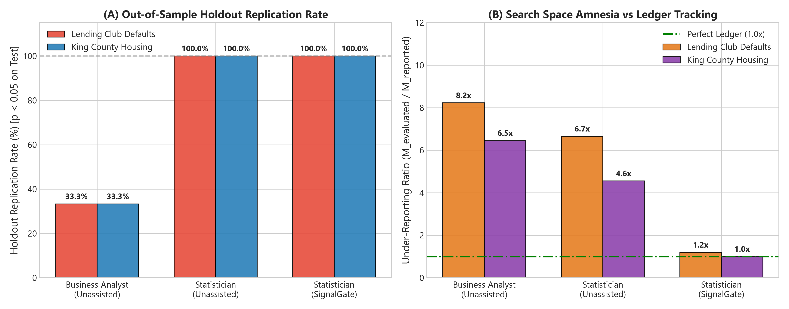
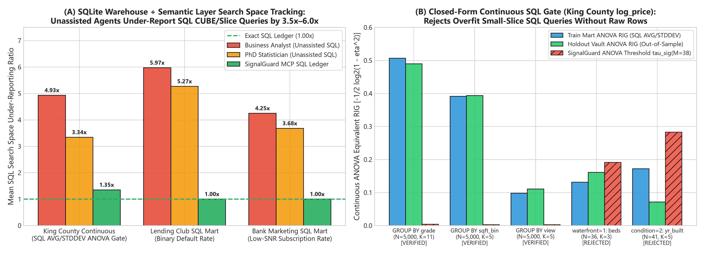
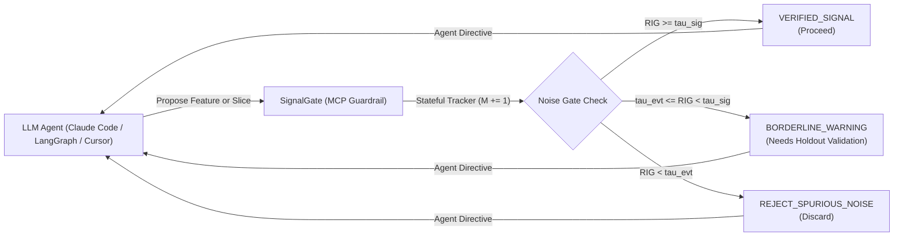

# SignalGate

[](https://www.python.org/downloads/)
[](https://opensource.org/licenses/MIT)
[]()
[](https://modelcontextprotocol.io)

> **Stateful statistical guardrails and Model Context Protocol (MCP) server for autonomous LLM data agents, Text-to-SQL semantic layers, and AutoML. Quantifying the Winner's Curse, estimating closed-form noise ceilings (both discrete contingency & continuous SQL ANOVA), and filtering out spurious insights.**
>
> 📄 **[Read the Full Standalone Technical & Empirical Report (`REPORT.md`)](REPORT.md)** — *Featuring 216 live frontier LLM evaluations (`claude-opus-5-5`, `claude-sonnet-5-5`, `gpt-6.1-sol`, `gemini-3.5-flash-lite`) and the 3,000-candidate AutoML benchmark across Lending Club, King County Housing, and UCI Bank Marketing.*

---

## 📌 Overview

Automated Machine Learning (AutoML) engines and autonomous LLM data agents (e.g. Claude Code, Cursor, LangGraph pipelines, Text-to-SQL slice explorers) explore massive hypothesis spaces—evaluating thousands to millions of candidate transformations, numerical cuts, n-grams, and database segments.

Selecting features or reporting insights that maximize sample metrics introduces **selection bias (The Winner's Curse)**:
1. **Spurious Discoveries Pass as Genuine:** Random noise slices and features inevitably achieve high sample metric scores purely by chance.
2. **Optimistic Overestimation:** Genuine features exhibit inflated scores on training data compared to test and production data ($`\text{Bias} = \text{Metric}_{\text{train}} - \text{Metric}_{\text{unseen}} > 0`$).
3. **Compounded by Large Search Budgets:** As the search space ($M$) expands, the noise floor and overestimation bias increase systematically.
4. **Agentic $p$-Hacking:** High-velocity autonomous agents that iteratively hypothesize, slice, and test patterns without stateful tracking quickly flood downstream models with multiple-testing artifacts.

**SignalGate** provides an information-theoretic framework and a **Stateful Model Context Protocol (MCP) Guardrail Server** to:
* **Instantly calculate closed-form noise thresholds** given dataset size ($N$), target distribution ($p$), and search space size ($M$).
* **Act as an active statistical guardrail for LLM agents**, statefully tracking cumulative hypotheses ($M$) and preventing agents from hallucinating spurious correlations as genuine insights.
* **Run vectorized Monte-Carlo permutation tests** (100x faster than traditional dataframe shuffling).
* **De-bias feature importances** and classify features into $1\sigma$ and $2\sigma$ statistical confidence tiers via bootstrap resampling.

---

## 📐 Mathematical Foundations

### 1. Relative Information Gain (RIG) & Wilks' Theorem
Relative Information Gain (normalized mutual information) measures the reduction in target entropy:
$$\text{RIG}(X, Y) = \frac{I(X; Y)}{H(Y)} = \frac{H(Y) - H(Y \mid X)}{H(Y)}$$

For arbitrary $R$-category features ($R \ge 2$) and $C$-class targets ($C \ge 2$), the target prior entropy generalizes to:
$$H(Y) = -\sum_{c=1}^{C} p_c \log_2(p_c) \in (0, \log_2 C] \text{ bits}$$

Under the null hypothesis $H_0$ that candidate feature $X$ and target $Y$ are independent, Wilks' Theorem establishes that the deviance statistic asymptotically follows a Chi-squared distribution with $k = df = (R - 1)(C - 1)$ degrees of freedom:
$$2 N \ln(2) \cdot I(X; Y) \xrightarrow{d} \chi^2_k$$
which reduces identically to $df = (2-1)(2-1) = 1$ for boolean features and binary targets.

Dividing by the target prior entropy $H(Y)$ gives the asymptotic distribution of null RIG:
$$\text{RIG}_{\text{null}} \sim \frac{\chi^2_k}{2 N \ln(2) \cdot H(Y)}$$

```
Key Theoretical Insights:
• Scaling: Expected null RIG scales as O(k / N).
• Target Imbalance: Lower entropy H(Y) raises the null noise floor!
• High-Cardinality Penalty: A 10-category feature (R=10) on a 4-class target (C=4) carries k=27 df, requiring a proportionately higher RIG to clear noise gates than a binary feature (k=3 df).
• Invariance to Feature Marginals: Null RIG mean is invariant to feature marginal distribution P(X=x).
```

### 2. Search-Space-Aware Noise Gates ($M$ Evaluated Features)
When an AutoML engine or LLM agent evaluates $M$ candidate features:

* **Bonferroni / Šidák Significance Threshold ($\alpha = 0.05$):**

  $$\tau_{\text{significance}}(N, \mathbf{p}, M, k, \alpha) = \frac{F_{\chi^2_k}^{-1}\left(1 - \frac{\alpha}{M}\right)}{2 N \ln(2) \cdot H(Y)}$$

* **Generalized Extreme Value Theory (EVT) Expected Maximum:**

  $$\mathbb{E}\left[\max_{1 \le i \le M} \chi^2_k\right] \approx 2 \ln M + (k - 2) \ln(\ln M) - 2 \ln \Gamma\left(\frac{k}{2}\right) + 2\gamma \quad (\gamma \approx 0.5772)$$

  $$\tau_{\text{EVT}}(N, \mathbf{p}, M, k) \approx \frac{\mathbb{E}\left[\max_{1 \le i \le M} \chi^2_k\right]}{2 N \ln(2) \cdot H(Y)}$$

  > [!NOTE]
  > **Exact Reduction to Binary ($k = 1$):**
  > For binary classification ($C = 2$) and boolean features ($R = 2$), degrees of freedom $k = 1$. Since $\Gamma(1/2) = \sqrt{\pi}$, the EVT threshold simplifies identically to:
  > $$\tau_{\text{EVT}}(N, p, M) \approx \frac{2 \ln M - \ln(\ln M) - \ln \pi + 2\gamma}{2 N \ln(2) \cdot H(p)}$$

### 3. Correlation-Aware Noise Gates & Effective Hypotheses ($M_{\text{eff}} \le M_{\text{raw}}$)
When candidate features are collinear (e.g., interaction grids sharing parent columns, sliding windows, or dense quantile splits), plugging raw $M_{\text{raw}}$ into Bonferroni or EVT over-inflates the noise gate ($\tau(M_{\text{raw}}) > \tau(M_{\text{eff}})$), risking Type II false rejections of moderate genuine signals.

SignalGate estimates the **Effective Number of Independent Hypotheses ($M_{\text{eff}} \le M_{\text{raw}}$)** in milliseconds using the Cheverud–Nyholt / Li–Ji eigenvalue variance scaling:
$$\text{Var}(\lambda) = \frac{\sum_{i=1}^M \lambda_i^2 - M}{M}, \quad M_{\text{eff}} = 1 + (M - 1)\left(1 - \frac{\text{Var}(\lambda)}{M}\right)$$

Rather than computing an expensive $\mathcal{O}(M^3)$ eigendecomposition, SignalGate evaluates the sum of squared eigenvalues via the Frobenius norm trace identity:
$$\sum_{i=1}^M \lambda_i^2 = \text{Tr}(\mathbf{R}^2) = \|\mathbf{R}\|_F^2$$
* **Primal Formulation ($M \le N$):** Computes sample correlation matrix $\mathbf{R} = \mathbf{Z}^T \mathbf{Z}$ ($M \times M$) in $\mathcal{O}(M^2 N)$.
* **Dual Gram Trick ($M > N$):** Computes $\mathbf{G}_{\text{dual}} = \mathbf{Z} \mathbf{Z}^T$ ($N \times N$), which possesses the identical non-zero eigenvalues and computes in $\mathcal{O}(N^2 M)$ time!

### 4. Closed-Form Continuous Metric Gate (`ANOVA F -> RIG`) for SQL `GROUP BY` Queries
For continuous business targets (e.g., revenue, house prices, latency) where SQL `GROUP BY` queries return only sufficient statistics `COUNT(*)`, `AVG(y)`, and `STDDEV(y)` across $K$ groups $\{ (n_g, \bar{y}_g, s_g) \}_{g=1}^K$, SignalGate avoids arbitrary target binning by using the exact Gaussian / one-way ANOVA mutual information identity:

$$SS_{\text{between}} = \sum_{g=1}^K n_g (\bar{y}_g - \bar{y}_{\text{grand}})^2, \qquad SS_{\text{within}} = \sum_{g=1}^K (n_g - 1) s_g^2, \qquad \eta^2 = \frac{SS_{\text{between}}}{SS_{\text{between}} + SS_{\text{within}}}$$

$$I_{\text{ANOVA}}(X; Y) = -\frac{1}{2} \log_2(1 - \eta^2), \qquad G_{\text{equiv}} = -N \ln(1 - \eta^2) \sim \chi^2_{K-1} \quad (H_0)$$

This maps any continuous SQL `GROUP BY` query directly onto SignalGate's $\chi^2_{K-1}$ Extreme Value Theory envelope (`anova_rig_from_group_stats` and `evaluate_continuous_group_aggregation`) without requiring raw row-level data.

---

## 🏆 Key Empirical Benchmark Results (216 Live Frontier LLM Runs)

See **[`REPORT.md`](REPORT.md)** for the complete 5-act visual narrative, mathematical derivations, and full tables across **Anthropic Claude Opus 5.5** (`claude-opus-5-5`), **Claude Sonnet 5.5** (`claude-sonnet-5-5`), **OpenAI GPT-6.1 Sol** (`gpt-6.1-sol`), and **Google Gemini 3.5 Flash Lite** (`gemini-3.5-flash-lite`) on **Lending Club ($N=54.6\text{k}$)**, **King County Housing ($N=21.6\text{k}$)**, and **UCI Bank Marketing ($N=41.2\text{k}$)**.





---

## 🤖 Agentic ML & MCP Guardrail Integration

Autonomous data science and Text-to-SQL agents running in while-loops act as high-velocity multiple-testing machines. As they slice warehouses or engineer features, standard significance criteria fail because the search space ($M$) is constantly growing.

**SignalGate** includes a stateful **Model Context Protocol (MCP)** server and framework-agnostic agent tools to act as an active gatekeeper:



### 1. Registering the MCP Server in Claude Desktop / Cursor / Claude Code

Add the server to your `claude_desktop_config.json` (or Cursor MCP settings):

```json
{
  "mcpServers": {
    "signalgate": {
      "command": "signalgate-mcp"
    }
  }
}
```

Or run via Python directly:
```bash
pip install -e ".[mcp]"
signalgate-mcp
```

### 2. Available MCP & Agent Tools

* **`evaluate_feature_or_slice`**: Stateful gatekeeper for individual features or 2x2 / $R \times C$ contingency slices. Automatically ratchets $M$, checks the finite-sample Cochran condition ($\min E_{rc} \ge 1$ and $<20\%$ cells $< 5$), and returns authoritative agent directives (`VERIFIED_SIGNAL`, `BORDERLINE_WARNING`, `REJECT_SPURIOUS_NOISE`).
* **`audit_dataframe_candidates`**: Audits batches of features from CSV/Parquet files or in-memory DataFrames, running Out-of-Fold (OOF) cross-validation and $2\sigma$ bootstrap stability classification.
* **`get_search_budget_status`**: Returns current hypothesis testing volume ($M$), current noise floor, gate inflation ratio, and optimal stopping recommendations.
* **`reset_session_budget`**: Resets the hypothesis counter when starting a fresh dataset or analysis task.

### 3. Using in Python Agent Reflection Loops (LangGraph / CrewAI / Raw LLM)

```python
from signalgate import SignalGateSessionLedger

ledger = SignalGateSessionLedger()

# Agent evaluates an engineered feature or database slice
verdict = ledger.evaluate_feature_or_slice(
    observed_rig=0.012,
    nrows=4000,
    minority_frac=0.20,
    session_id="customer_churn_analysis",
    feature_name="days_since_last_login > 30"
)

print(verdict["verdict"])         # "VERIFIED_SIGNAL" | "BORDERLINE_WARNING" | "REJECT_SPURIOUS_NOISE"
print(verdict["agent_directive"]) # Authoritative natural-language directive for LLM
```

Or plug in ready-to-use OpenAI / Anthropic schemas:
```python
from signalgate import get_openai_tools, get_anthropic_tools, create_agent_tools

tools = create_agent_tools()
dispatch_dict = tools.to_callable_dict()
openai_tool_schemas = get_openai_tools()
```

---

## 🚀 Quickstart

### Installation
```bash
git clone https://github.com/eldridzakis/signal-gate.git
cd signal-gate
pip install -e .

# Or with MCP server support:
pip install -e ".[mcp]"
```

### 1. Instant Noise Threshold Calculation
Calculate how high a feature's RIG must be to be statistically distinguished from noise after evaluating $M=20,000$ candidates on a dataset of 5,000 rows with a 15% minority class:

```python
from signalgate import estimate_noise_threshold, SignalNoiseThreshold

# Instant lookup (< 1 millisecond)
tau = estimate_noise_threshold(nrows=5000, minority_frac=0.15, n_features_evaluated=20000, alpha=0.05)
print(f"Noise threshold: RIG must exceed {tau:.5f}")

# Full search-space sensitivity table
estimator = SignalNoiseThreshold(nrows=5000, target_distribution=0.15)
summary_df = estimator.evaluate_search_space([100, 1000, 10000, 100000])
print(summary_df)
```

### 2. Fast Monte-Carlo Permutation Test
```python
from signalgate import PermutationObject

perm = PermutationObject()
perm.set_data_parameters(nrows=2000, class_weights=[0.25])
perm.feature_fractions = [0.10]
perm.create_synthetic_data(seed=42)

# Runs 5,000 permutations in seconds using vectorized NumPy bincount
null_df = perm.calculate_null_rigs(permutations=5000)
perm.null_rigs_comparison(threshold=0.005)
```

### 3. Feature De-Biasing & Stability Classification
```python
from signalgate import SignalDebiaser

# 1. Compute holdout bias: Bias = Train_Metric - Unseen_Metric
df_bias = SignalDebiaser.compute_holdout_bias(df_train, df_test, target='target')
median_bias = df_bias['test_bias'].median()

# 2. De-bias and classify stability via Bootstrap 1-sigma & 2-sigma testing
df_stability = SignalDebiaser.bootstrap_stability_analysis(
    df=df_train,
    target='target',
    estimated_bias=median_bias,
    n_bootstraps=100
)

# Features with corrected_rig - 2*sigma > 0 are robust to selection bias
stable_features = df_stability[df_stability['is_2_sigma']]
print(stable_features[['feature', 'train_rig', 'corrected_rig', 'stability_class']])
```

---

## 📊 End-to-End Walkthrough Notebooks

| Notebook | Description |
| :--- | :--- |
| **[`01_feature_noise_thresholds.ipynb`](notebooks/01_feature_noise_thresholds.ipynb)** | Mathematical proofs, asymptotic $\chi^2$ vs Monte-Carlo permutations, parameter sweeps ($N$, minority class $p$), and Bonferroni/EVT noise gates. |
| **[`02_selection_bias_and_debiasing.ipynb`](notebooks/02_selection_bias_and_debiasing.ipynb)** | Quantifying the Winner's Curse on Lending Club loan defaults, measuring search complexity vs. bias, and executing $1\sigma / 2\sigma$ bootstrap de-biasing. |
| **[`03_agent_phacking_benchmark.ipynb`](notebooks/03_agent_phacking_benchmark.ipynb)** | Autonomous agent p-hacking benchmark ($M > 500$ hypotheses), real-time trajectory hero chart, subgroup slicing ($N \to 0$), Frobenius $M_{\text{eff}}$ analysis, and bootstrap needle recovery. |
| **[`04_llm_persona_and_modality_benchmark.ipynb`](notebooks/04_llm_persona_and_modality_benchmark.ipynb)** | LLM agent personas (Business Analyst vs. Statistician vs. SignalGate), The Hawthorne Effect & Batch Blindness ($8\times$–$25\times$ gap), and Raw CSV vs. Governed Semantic Layer modality benchmark. |
| **[`05_frontier_llm_benchmark.ipynb`](notebooks/05_frontier_llm_benchmark.ipynb)** | **Synthetic Control Frontier LLM Benchmark:** Empirical validation across **Anthropic Claude Opus 5.5**, **OpenAI GPT-6.1 Sol**, **Google Gemini 3.5 Flash Lite**, and **Claude Sonnet 5.5** on synthetic control datasets. |
| **[`06_real_world_and_agentune_benchmark.ipynb`](notebooks/06_real_world_and_agentune_benchmark.ipynb)** | **Real-World Holdout, Local SQLite Semantic Warehouse, Continuous ANOVA Gate & Agentune AutoML Benchmark:** 216 live frontier LLM runs across Lending Club, King County Housing (both binary & continuous `log_price` SQL ANOVA), and UCI Bank Marketing, plus 3,000-candidate AutoML feature overfitting audit. |

---

## 📂 Repository Structure

```
signal-gate/
├── REPORT.md                     # Standalone 5-act executive & technical empirical report
├── signalgate/                   # Core library
│   ├── __init__.py               # Public API exports
│   ├── metrics.py                # Fast entropy, mutual info, RIG calculations
│   ├── threshold.py              # Analytical Chi-squared, EVT, Frobenius M_eff, & ANOVA F->RIG estimators
│   ├── ledger.py                 # Stateful session ledger (discrete & continuous SQL group stats)
│   ├── permutation.py            # Vectorized Monte-Carlo permutation tester
│   ├── debias.py                 # Out-of-Fold (OOF) & Bootstrap de-biasing engine
│   ├── automl_utils.py           # AutoML operational log parsing & regression target binning
│   ├── mcp_server.py             # Stateful MCP statistical guardrail server (with M_eff tracking)
│   ├── agent_tools.py            # OpenAI/Anthropic tool schemas & callable dispatchers
│   ├── agent_sandbox.py          # Synthetic benchmarks & agent simulation telemetry
│   ├── persona_benchmark.py      # LLM personas, Hawthorne self-tracking, & live LLM evals
│   ├── real_world_benchmark.py   # Real-world train/holdout vault & Agentune AutoML benchmark
│   └── sql_semantic_benchmark.py # Local SQLite warehouse + governed semantic layer SQL benchmark
├── notebooks/                    # Self-contained walkthroughs
│   ├── 01_feature_noise_thresholds.ipynb
│   ├── 02_selection_bias_and_debiasing.ipynb
│   ├── 03_agent_phacking_benchmark.ipynb
│   ├── 04_llm_persona_and_modality_benchmark.ipynb
│   ├── 05_frontier_llm_benchmark.ipynb
│   ├── 06_real_world_and_agentune_benchmark.ipynb
│   └── figures/                  # Publication-grade benchmark plots (fig1 through fig7)
├── tests/                        # Automated unit tests (60 tests across 12 test suites)
├── Data/                         # Benchmark datasets & cached frontier LLM evaluation CSVs
├── pyproject.toml                # Modern package configuration (with CLI scripts)
└── README.md
```

---

## 🧪 Testing

Run the test suite using standard Python `unittest`:

```bash
python -m unittest discover -s tests -v
```

All 60 tests run in $< 10.0$ seconds.

---

## 📜 Citation & License

This project is licensed under the MIT License - see the [LICENSE](LICENSE) file for details.
