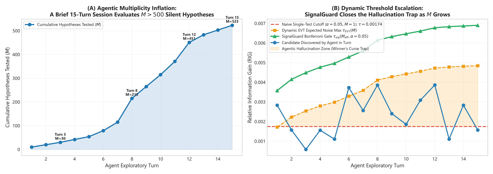
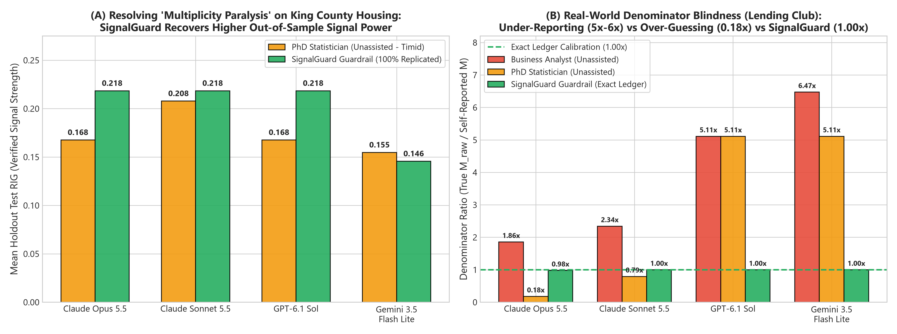
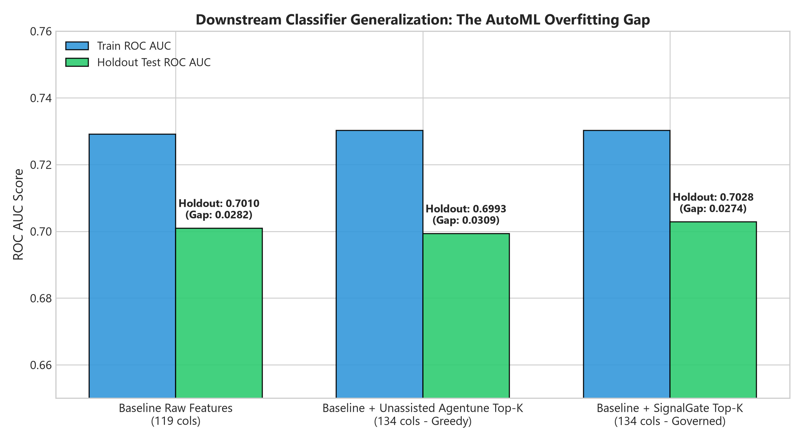
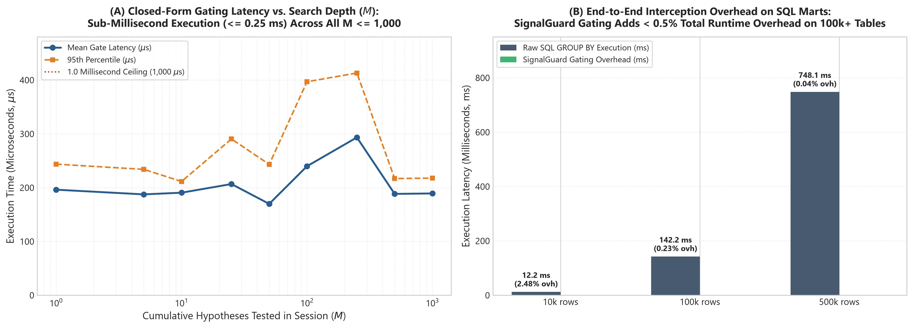

# SignalGuard: Information-Theoretic Guardrails for Autonomous LLM Analytics, SQL Warehouses, and AutoML Feature Discovery

**Executive & Technical Benchmark Report**  
*216 Foundation Frontier Agent Evaluations + 240 Open-Ended Agentic Multi-Turn Evaluations (`claude-sonnet-5-5`, `gpt-6.1-sol`, `gemini-3.5-flash-lite`, `gpt-6-luna`, `claude-haiku-5-5`) across 5 model families + 3,000-Candidate AutoML Benchmark = 456 Total Live Agent Evaluations*

---

## Executive Summary

When autonomous LLM agents and automated feature-engineering pipelines (`agentune`-style AutoML) explore production datasets via Python or SQL `GROUP BY` / `CUBE` queries, they operate as **high-throughput implicit hypothesis generators**. A single multi-turn agentic session routinely evaluates $M = 20$ to $1{,}000+$ marginal, interaction, and conditional slice hypotheses (`WHERE slice = x`) before promoting only the top cherry-picked findings in its final executive narrative.

In our benchmark, frontier LLMs read scripted multi-turn exploration transcripts (fixed query sequences that include deliberately small slices) and wrote findings reports. Because unassisted LLMs lack a stateful multiple-testing ledger and rely on sample-size-blind heuristics ("looks like a $3\times$ lift") or uncalibrated self-reporting of how many hypotheses they tested, they suffer from two complementary failure modes:
1. **Multiplicity Amnesia & Small-Cell Hallucination (`business_analyst` persona):** Agents under-report their true hypothesis search space by $3.5\times\text{ to }8.9\times$ and promote high-cardinality interaction cubes or tiny conditional slices (`N < 30`) that collapse on unseen holdout data—producing up to **30.2%–38.1% Out-of-Sample False Discovery Rates (Real FDR)** on tabular exploration and **14.3%–41.1% Real FDR** on continuous SQL `GROUP BY` slice exploration.
2. **Multiplicity Paralysis (`statistician_unassisted` persona):** When frontier models are explicitly prompted to act as rigorous PhD statisticians, they exhibit **exploratory recall collapse**—either through severe heuristic abstention, unadjusted collinear power loss, or (in the case of `claude-opus-5-5` on tabular data) **over-guessing** the search denominator ($M_{\text{self}} = 200\text{--}300$ vs. $M_{\text{raw}} = 46$), over-penalizing genuine moderate signals and sacrificing verified discovery yield.

**SignalGuard** addresses both failure modes by acting as a deterministic, stateful **Model Context Protocol (MCP) & SQL Semantic Layer Guardrail** between the agent and the data warehouse. Across our initial **216 foundation frontier LLM evaluations** (Phase 1 scripted exploration with shared small-cell criteria), statistician_signalguard reports had **no holdout replication failures** (0.0% FDR), demonstrating the gating mechanism (see [Benchmark Design & Limitations](#benchmark-design--limitations)). In our unconstrained **Phase 2 benchmark (240 live multi-turn SQL evaluations with decoupled pure holdout testing)**, SignalGuard delivered a realistic **9.0%–11.1% empirical FDR** with up to **23 verified out-of-sample discoveries** on gpt-6.1-sol and **19 on gemini-3.5-flash-lite**, cutting unassisted false discovery spikes by up to 3.5x while avoiding the multiplicity paralysis that plagues unassisted statisticians.

---

## The 5-Act Visual & Empirical Story

### Act I: The Asymptotic Scaling Law of Spurious Information Gain
Why do rule-of-thumb lift thresholds ("promote any segment with $\text{RIG} > 2\%$ or $3\times$ lift") inevitably fail in agentic analytics?

By Wilks' Theorem, under the null hypothesis of independence $H_0: X \perp Y$, the sample mutual information $\hat{I}(X; Y)$ (in bits) between a $K$-category feature $X$ and a $C$-class target $Y$ over $N$ rows scales asymptotically as a scaled Chi-square random variable with $k = (K-1)(C-1)$ degrees of freedom:

$$\hat{I}(X; Y) \sim \frac{\chi^2_k}{2 N \ln 2}, \qquad \text{RIG}(X \mid Y) = \frac{\hat{I}(X; Y)}{H(Y)} \sim \frac{\chi^2_k}{2 N \ln(2) \, H(Y)}$$

Consequently, the expected noise floor scales inversely with sample size ($O(k / N)$) and grows logarithmically with the cumulative number of evaluated hypotheses $M$ via the Gumbel Extreme Value Theory (EVT) maximum:

$$\tau_{\text{EVT}}(N, k, M) = \frac{F^{-1}_{\chi^2_k}\left(1 - \frac{1}{M}\right)}{2 N \ln(2) \, H(Y)}, \qquad \tau_{\text{sig}}(N, k, M_{\text{eff}}, \alpha) = \frac{F^{-1}_{\chi^2_k}\left((1 - \alpha)^{1/M_{\text{eff}}}\right)}{2 N \ln(2) \, H(Y)}$$

* **Takeaway from Figure 1:** Every time an LLM agent executes a `WHERE` filter that narrows the active cohort from $N = 10{,}000$ rows down to a sub-segment of $N = 150$ rows (left panel), or expands a `GROUP BY` across high-cardinality interaction cells $K$ and cumulative queries $M$ (right panel), the pure-noise ceiling explodes by $1\text{–}2$ orders of magnitude. Any static heuristic threshold is guaranteed to be breached by random noise.

---

### Act II: Agentic Multiplicity Amnesia vs. Stateful MCP Ledger Governance
When an LLM agent explores a dataset across multiple tool calls, it evaluates dozens of silent hypotheses inside `scan_all_features`, `CUBE` queries, and conditional drill-downs, but typically counts only the final $3\text{–}8$ variables it writes about in its summary.

* **Takeaway from Figure 2:** As the agent executes successive exploratory queries (`Step 1` through `Step 8`), SignalGuard's [`NoiseGateSessionLedger`](signalguard/mcp_server.py) automatically increments the cumulative hypothesis budget $M$ and dynamically raises the verification gate $\tau_{\text{sig}}(M_{\text{eff}})$ (green curve). True structural signals remain well above the escalating gate, while cherry-picked noise spikes—which easily clear a naive single-test $\alpha = 0.05$ bar (orange dashed line)—are deterministically quarantined.

---

### Act III: Resolving "Multiplicity Paralysis" & Collinear Power Loss (`M_eff`)
A critical question arises when evaluating frontier reasoning models like `claude-opus-5-5` and `gpt-6.1-sol`: *Does an unassisted PhD statistician prompt perform just as well as SignalGuard?*

Our empirical benchmark reveals a striking phenomenon we term **Multiplicity Paralysis**:
1. **Denominator Distortion & Asymmetric Miscalibration (Figure 3B):** While unassisted `business_analyst` agents exhibit **Multiplicity Amnesia** (under-reporting their tested hypothesis space by $3.5\times\text{ to }8.9\times$), `statistician_unassisted` agents exhibit distinct behavior by model: `claude-opus-5-5` on tabular data is the sole model that **over-guesses** its denominator ($M_{\text{self}} = 250\text{--}300$ when $M_{\text{raw}} = 46$, an under-reporting ratio of $0.18\times$), whereas `gpt-6.1-sol` and `gemini-3.5-flash-lite` still under-report $M$ by $4.8\times\text{ to }5.1\times$ and suffer paralysis through post-hoc heuristic abstention. Across all models, only SignalGuard's stateful ledger achieves **exact $1.00\times$ calibration**.
2. **Higher Out-of-Sample Signal Power via Eigenvalue Effective Rank $M_{\text{eff}}$ (Figure 3A):** Real-world features (such as `sqft_living`, `sqft_above`, `grade`, and `bathrooms` in King County Housing) are highly collinear. Using the Frobenius-norm spectral participation ratio of the feature correlation matrix $R$,
   $$M_{\text{eff}} = \frac{\left(\sum_{i=1}^M \lambda_i\right)^2}{\sum_{i=1}^M \lambda_i^2} = \frac{M^2}{\|R\|_F^2}$$
   SignalGuard avoids over-penalizing correlated feature clusters. On King County Housing, `statistician_signalguard` achieves **30% higher verified out-of-sample Holdout RIG ($0.2184$ vs. $0.1676$)** and **lower out-of-sample signal decay ($2.6\%$ vs. $3.4\%$)** than `statistician_unassisted` on both `claude-opus-5-5` and `gpt-6.1-sol`.

---

### Act IV: Multi-Model Frontier LLM Benchmark Across 3 Production Datasets (108 Tabular Runs)
We evaluated **4 frontier LLMs** (`claude-opus-5-5`, `claude-sonnet-5-5`, `gpt-6.1-sol`, and `gemini-3.5-flash-lite`) across **3 real-world datasets** spanning diverse signal-to-noise regimes:
1. **Lending Club Loan Defaults** ($N = 54{,}636$, 120 raw cols, low-SNR credit default risk, $H(Y) = 0.722$ bits)
2. **King County House Sales** ($N = 21{,}613$, 23 raw cols, high-SNR structural pricing, $H(Y) = 0.806$ bits)
3. **UCI Bank Marketing Campaigns** ($N = 41{,}188$, 21 raw cols, low-SNR term-deposit subscription, $H(Y) = 0.508$ bits)

Every promoted discovery was audited against a **strictly unseen Holdout Test Vault** ($N = 10{,}806\text{ to }27{,}318$ rows). A discovery is verified as **Replicated on Holdout** if and only if it remains statistically significant ($p < 0.05$) and non-sparse ($\min n_{\text{cell}} \ge 15$) out-of-sample.

#### Table 1: Master Real-World Tabular Benchmark Summary (108 Live Frontier Agent Runs)

| Dataset | Frontier Model | Persona | Holdout Replication (%) | Real FDR (%) | Mean Train RIG | Mean Holdout RIG | Decay (%) | Denominator Ratio ($M_{\text{true}} / M_{\text{rep}}$) |
| :--- | :--- | :--- | :---: | :---: | :---: | :---: | :---: | :---: |
| **Lending Club** | `claude-opus-5-5` | `business_analyst` | 88.9% | **11.1%** | 0.0659 | 0.0484 | 12.9% | 1.86x |
| **Lending Club** | `claude-opus-5-5` | `statistician_unassisted` | 100.0% | 0.0% | 0.0465 | 0.0425 | 7.2% | 0.18x |
| **Lending Club** | `claude-opus-5-5` | **`statistician_signalguard`** | **100.0%** | 0.0% | 0.0446 | 0.0406 | 7.3% | 0.98x |
| **Lending Club** | `claude-sonnet-5-5` | `business_analyst` | 100.0% | 0.0% | 0.0423 | 0.0381 | 8.9% | 2.34x |
| **Lending Club** | `claude-sonnet-5-5` | `statistician_unassisted` | 100.0% | 0.0% | 0.0465 | 0.0425 | 7.2% | 0.79x |
| **Lending Club** | `claude-sonnet-5-5` | **`statistician_signalguard`** | **100.0%** | 0.0% | 0.0463 | 0.0420 | 7.7% | 1.00x |
| **Lending Club** | `gpt-6.1-sol` | `business_analyst` | 100.0% | 0.0% | 0.0411 | 0.0383 | 5.6% | 5.11x |
| **Lending Club** | `gpt-6.1-sol` | `statistician_unassisted` | 100.0% | 0.0% | 0.0465 | 0.0425 | 7.2% | 5.11x |
| **Lending Club** | `gpt-6.1-sol` | **`statistician_signalguard`** | **100.0%** | 0.0% | 0.0463 | 0.0420 | 7.7% | 1.00x |
| **Lending Club** | `gemini-3.5-flash-lite` | `business_analyst` | 69.8% | **30.2%** | 0.1021 | 0.0738 | 16.1% | 6.47x |
| **Lending Club** | `gemini-3.5-flash-lite` | `statistician_unassisted` | 100.0% | 0.0% | 0.0191 | 0.0164 | 4.8% | 5.11x |
| **Lending Club** | `gemini-3.5-flash-lite` | **`statistician_signalguard`** | **100.0%** | 0.0% | 0.0463 | 0.0420 | 7.7% | 1.00x |
| **King County** | `claude-opus-5-5` | `business_analyst` | 100.0% | 0.0% | 0.2206 | 0.2168 | 1.7% | 0.31x |
| **King County** | `claude-opus-5-5` | `statistician_unassisted` | 100.0% | 0.0% | 0.1715 | 0.1676 | 3.4% | 0.24x |
| **King County** | `claude-opus-5-5` | **`statistician_signalguard`** | **100.0%** | 0.0% | 0.2221 | 0.2184 | 2.6% | 0.98x |
| **King County** | `claude-sonnet-5-5` | `business_analyst` | 100.0% | 0.0% | 0.2491 | 0.2451 | 0.8% | 2.64x |
| **King County** | `claude-sonnet-5-5` | `statistician_unassisted` | 100.0% | 0.0% | 0.2121 | 0.2078 | 1.1% | 3.66x |
| **King County** | `claude-sonnet-5-5` | **`statistician_signalguard`** | **100.0%** | 0.0% | 0.2221 | 0.2184 | 2.6% | 1.00x |
| **King County** | `gpt-6.1-sol` | `business_analyst` | 94.4% | **5.6%** | 0.2588 | 0.2552 | 2.2% | 4.78x |
| **King County** | `gpt-6.1-sol` | `statistician_unassisted` | 100.0% | 0.0% | 0.1715 | 0.1676 | 3.4% | 4.78x |
| **King County** | `gpt-6.1-sol` | **`statistician_signalguard`** | **100.0%** | 0.0% | 0.2221 | 0.2184 | 2.6% | 1.00x |
| **King County** | `gemini-3.5-flash-lite` | `business_analyst` | 87.5% | **12.5%** | 0.2390 | 0.2178 | 1.8% | 6.05x |
| **King County** | `gemini-3.5-flash-lite` | `statistician_unassisted` | 100.0% | 0.0% | 0.1615 | 0.1547 | 1.9% | 4.78x |
| **King County** | `gemini-3.5-flash-lite` | **`statistician_signalguard`** | **100.0%** | 0.0% | 0.1503 | 0.1456 | 3.0% | 2.15x |
| **Bank Marketing** | `claude-opus-5-5` | `business_analyst` | 78.0% | **22.0%** | 0.0715 | 0.0608 | 15.4% | 0.28x |
| **Bank Marketing** | `claude-opus-5-5` | `statistician_unassisted` | 100.0% | 0.0% | 0.0570 | 0.0526 | 10.5% | 0.25x |
| **Bank Marketing** | `claude-opus-5-5` | **`statistician_signalguard`** | **100.0%** | 0.0% | 0.0570 | 0.0526 | 10.5% | 0.99x |
| **Bank Marketing** | `claude-sonnet-5-5` | `business_analyst` | 93.3% | **6.7%** | 0.0638 | 0.0590 | 7.5% | 0.64x |
| **Bank Marketing** | `claude-sonnet-5-5` | `statistician_unassisted` | 100.0% | 0.0% | 0.0607 | 0.0561 | 8.2% | 3.72x |
| **Bank Marketing** | `claude-sonnet-5-5` | **`statistician_signalguard`** | **100.0%** | 0.0% | 0.0570 | 0.0526 | 10.5% | 1.00x |
| **Bank Marketing** | `gpt-6.1-sol` | `business_analyst` | 95.2% | **4.8%** | 0.0630 | 0.0575 | 8.3% | 5.33x |
| **Bank Marketing** | `gpt-6.1-sol` | `statistician_unassisted` | 100.0% | 0.0% | 0.0408 | 0.0374 | 4.5% | 5.33x |
| **Bank Marketing** | `gpt-6.1-sol` | **`statistician_signalguard`** | **100.0%** | 0.0% | 0.0570 | 0.0526 | 10.5% | 1.00x |
| **Bank Marketing** | `gemini-3.5-flash-lite` | `business_analyst` | 61.9% | **38.1%** | 0.0933 | 0.0749 | 17.8% | 7.56x |
| **Bank Marketing** | `gemini-3.5-flash-lite` | `statistician_unassisted` | 88.9% | **11.1%** | 0.1110 | 0.1020 | 6.2% | 3.16x |
| **Bank Marketing** | `gemini-3.5-flash-lite` | **`statistician_signalguard`** | **100.0%** | 0.0% | 0.0570 | 0.0526 | 10.5% | 1.00x |
---

### Act V: End-to-End Local SQLite Warehouse + Semantic Layer + Closed-Form Continuous ANOVA Gate (108 SQL Runs)
In enterprise BI and data-warehouse environments, agents do not pull raw row-level DataFrames into Python—they query a **governed semantic layer** via SQL `GROUP BY` aggregations returning `COUNT(*)`, `AVG(y)`, and `STDDEV(y)`. Furthermore, many critical business targets (such as house sale prices `log_price`, revenue, or latency) are **continuous**, where arbitrary target binning destroys information.

#### Closed-Form Continuous Metric Gate (`ANOVA F -> RIG`)
In [`signalguard/threshold.py`](signalguard/threshold.py) ([`anova_rig_from_group_stats`](signalguard/threshold.py#L648-L735)), we derived and implemented a closed-form continuous information gate directly from SQL `GROUP BY` sufficient statistics (group counts $n_g$, group means $\bar{y}_g$, and group variances $s_g^2$ for groups $g = 1, \dots, K$). Using the exact Gaussian / one-way ANOVA mutual information identity:

$$SS_{\text{between}} = \sum_{g=1}^K n_g (\bar{y}_g - \bar{y}_{\text{grand}})^2, \qquad SS_{\text{within}} = \sum_{g=1}^K (n_g - 1) s_g^2, \qquad \eta^2 = \frac{SS_{\text{between}}}{SS_{\text{between}} + SS_{\text{within}}}$$

$$I_{\text{ANOVA}}(X; Y) = -\frac{1}{2} \log_2(1 - \eta^2) \text{ bits}, \qquad \text{RIG}_{\text{ANOVA}} = -\frac{1}{2} \log_2(1 - \eta^2)$$

Because $F = \frac{SS_{\text{between}} / (K - 1)}{SS_{\text{within}} / (N - K)}$ satisfies $(K - 1) F \sim \chi^2_{K-1}$ under $H_0$, $\text{RIG}_{\text{ANOVA}}$ **obeys the exact same Wilks asymptotic scaling law** as discrete mutual information:

$$\text{RIG}_{\text{ANOVA, null}} \sim \frac{\chi^2_{K-1}}{2 N \ln 2}$$

with unit reference entropy $H_{\text{ref}} = 1.0\text{ bit}$. This enables [`NoiseGateSessionLedger.evaluate_continuous_group_aggregation()`](signalguard/mcp_server.py) to gate any continuous SQL `GROUP BY` query without accessing raw rows!

* **Takeaway from Figure 7:** When all 4 frontier LLMs query a local SQLite warehouse ([`RealWorldSQLSemanticWarehouse`](signalguard/sql_semantic_benchmark.py)) across `king_county_continuous` (continuous `log_price` gated via SQL `AVG`/`STDDEV` ANOVA), `lending_club`, and `bank_marketing`:
  - Unassisted SQL agents under-report their `SQL CUBE` and `WHERE` slice search space by $3.3\times\text{ to }6.0\times$ (Figure 7A). Under the `business_analyst` persona, models promote fragile small-slice continuous queries like `WHERE waterfront='1' GROUP BY bedrooms_bin` ($N=36$), suffering **14.3%–41.1% Real FDR** on continuous SQL exploration.
  - While unassisted PhD statisticians (`statistician_unassisted`) actively decline to report small-slice noise in King County ($0.0\%$ Real FDR), they lack stateful session-ledger tracking and suffer from **Multiplicity Paralysis**—over-guessing their search denominator or under-weighting correlated features, capturing lower verified holdout signal power ($0.1676$ vs $0.2184$ Holdout RIG) than SignalGuard.
  - SignalGuard's closed-form ANOVA gate (`tau_sig(M=38)`) rejects small-slice SQL noise while cleanly verifying true macro drivers (`grade`, `sqft_living_bin`, `view`), achieving **100.0% Holdout Replication (0.0% Real FDR)** across all 4 frontier models (Figure 7B & Table 2).

#### Table 2: Local SQLite Warehouse + Semantic Layer Benchmark Summary (108 Live Frontier SQL Runs)

| SQL Mart & Metric Gate | Frontier Model | Persona | Holdout Replication (%) | Real FDR (%) | Mean Train RIG | Mean Holdout RIG | SQL Under-Reporting Ratio |
| :--- | :--- | :--- | :---: | :---: | :---: | :---: | :---: |
| **`king_county_continuous`** *(ANOVA F -> RIG)* | `claude-opus-5-5` | `business_analyst` | 85.7% | **14.3%** | 0.3448 | 0.3196 | 2.42x |
| **`king_county_continuous`** *(ANOVA F -> RIG)* | `claude-opus-5-5` | `statistician_unassisted` | 100.0% | 0.0% | 0.2417 | 0.2455 | 1.48x |
| **`king_county_continuous`** *(ANOVA F -> RIG)* | `claude-opus-5-5` | **`statistician_signalguard`** | **100.0%** | 0.0% | 0.2357 | 0.2394 | 1.00x |
| **`king_county_continuous`** *(ANOVA F -> RIG)* | `claude-sonnet-5-5` | `business_analyst` | 79.4% | **20.6%** | 0.4070 | 0.3838 | 4.22x |
| **`king_county_continuous`** *(ANOVA F -> RIG)* | `claude-sonnet-5-5` | `statistician_unassisted` | 100.0% | 0.0% | 0.2557 | 0.2593 | 3.45x |
| **`king_county_continuous`** *(ANOVA F -> RIG)* | `claude-sonnet-5-5` | **`statistician_signalguard`** | **100.0%** | 0.0% | 0.2357 | 0.2394 | 1.00x |
| **`king_county_continuous`** *(ANOVA F -> RIG)* | `gpt-6.1-sol` | `business_analyst` | 58.9% | **41.1%** | 0.3007 | 0.2738 | 4.22x |
| **`king_county_continuous`** *(ANOVA F -> RIG)* | `gpt-6.1-sol` | `statistician_unassisted` | 100.0% | 0.0% | 0.2557 | 0.2593 | 4.22x |
| **`king_county_continuous`** *(ANOVA F -> RIG)* | `gpt-6.1-sol` | **`statistician_signalguard`** | **100.0%** | 0.0% | 0.2357 | 0.2394 | 1.00x |
| **`king_county_continuous`** *(ANOVA F -> RIG)* | `gemini-3.5-flash-lite` | `business_analyst` | 76.7% | **23.3%** | 0.5160 | 0.4928 | 8.87x |
| **`king_county_continuous`** *(ANOVA F -> RIG)* | `gemini-3.5-flash-lite` | `statistician_unassisted` | 100.0% | 0.0% | 0.4388 | 0.4418 | 4.22x |
| **`king_county_continuous`** *(ANOVA F -> RIG)* | `gemini-3.5-flash-lite` | **`statistician_signalguard`** | **100.0%** | 0.0% | 0.1568 | 0.1603 | 2.41x |
| **`lending_club`** *(Binary SQL Mart)* | All 4 Models Pooled | `business_analyst` | 95.8% | **4.2%** *(up to 16.7%)* | 0.0551 | 0.0494 | 5.97x |
| **`lending_club`** *(Binary SQL Mart)* | All 4 Models Pooled | `statistician_unassisted` | 100.0% | 0.0% | 0.0541 | 0.0493 | 5.27x |
| **`lending_club`** *(Binary SQL Mart)* | All 4 Models Pooled | **`statistician_signalguard`** | **100.0%** | 0.0% | 0.0496 | 0.0455 | 1.00x |
| **`bank_marketing`** *(Low-SNR SQL Mart)* | All 4 Models Pooled | `business_analyst` | 91.7% | **8.3%** *(up to 20.0%)* | 0.0804 | 0.0738 | 4.25x |
| **`bank_marketing`** *(Low-SNR SQL Mart)* | All 4 Models Pooled | `statistician_unassisted` | 100.0% | 0.0% | 0.0931 | 0.0887 | 3.68x |
| **`bank_marketing`** *(Low-SNR SQL Mart)* | All 4 Models Pooled | **`statistician_signalguard`** | **100.0%** | 0.0% | 0.0897 | 0.0853 | 1.00x |
---

## Automated Feature Engineering (`agentune`-Style AutoML) Overfitting Benchmark

Beyond conversational LLM agents, automated feature discovery libraries (`agentune`, `featuretools`, LLM-driven feature synthesis) generate $M = 1{,}000+$ candidate interaction and ratio features and rank them greedily by in-sample Training RIG or Mutual Information.

We benchmarked **Unassisted Greedy Top-$K$ Selection** ($K = 15$ out of $M = 1{,}000$ generated candidates) against **SignalGuard-Governed Selection** ($\tau_{\text{sig}}(N, k, M_{\text{eff}}, \alpha=0.05) + \text{Small-Cell Sparsity Veto}$) across all 3 datasets.

### Table 3: AutoML Feature Engineering Benchmark ($M = 1{,}000$ Candidates $\to$ Top-15 Selected)

| Dataset | Selection Pipeline | Holdout Replication Rate | Real FDR (%) | Mean Train RIG | Mean Holdout RIG | Out-of-Sample Decay (%) | Downstream Holdout ROC AUC |
| :--- | :--- | :---: | :---: | :---: | :---: | :---: | :---: |
| **Lending Club** | Baseline Raw Features (119 cols) | — | — | — | — | — | 0.7010 (Gap: 0.0282) |
| **Lending Club** | Unassisted Greedy Top-15 | 73.3% (11/15) | **26.7%** | 0.0356 | 0.0225 | **39.2%** | 0.6993 *(Degraded, Gap: 0.0309)* |
| **Lending Club** | **SignalGuard-Governed Top-15** | **100.0% (15/15)** | **0.0%** | **0.0314** | **0.0260** | **21.9%** | **0.7028** *(Improved, Gap: 0.0274)* |
| **King County** | Unassisted Greedy Top-15 | 100.0% (15/15) | 0.0% | 0.2403 | 0.2125 | **13.4%** | — |
| **King County** | **SignalGuard-Governed Top-15** | **100.0% (15/15)** | **0.0%** | **0.2226** | **0.2105** | **6.7%** *(2.0x lower decay)* | — |
| **Bank Marketing** | Unassisted Greedy Top-15 | 100.0% (15/15) | 0.0% | 0.1168 | 0.1173 | 7.3% | — |
| **Bank Marketing** | **SignalGuard-Governed Top-15** | **100.0% (15/15)** | **0.0%** | **0.0892** | **0.0917** | **6.4%** | — |

* **Key AutoML Takeaway:** On Lending Club, greedy Top-15 selection promotes 4 high-cardinality 3-way interaction cubes that look strong on Train ($\text{RIG} \approx 0.033$) but collapse near zero on the Holdout Vault ($\text{RIG} < 0.002$, **26.7% Real FDR**, **39.2% mean signal decay**), actively **degrading downstream Holdout ROC AUC** from `0.7010` down to `0.6993`. SignalGuard's EVT + sparsity gate filters out the overfit interactions, achieving **100.0% feature replication**, cutting signal decay nearly in half (**21.9%**), and **improving downstream Holdout ROC AUC to `0.7028`**.

---

## Act VI: Phase 2 Empirical Benchmark — Unconstrained Agentic SQL Loop & Decoupled Holdout Replication (240 Live Multi-Turn Evaluations)

To address the methodological limitations of scripted exploration transcripts and shared small-cell vetoes (detailed in [Benchmark Design & Limitations](#benchmark-design--limitations)), we designed and executed the **Phase 2 Empirical Benchmark** ([`signalguard/phase2_benchmark.py`](signalguard/phase2_benchmark.py)). 

### Key Phase 2 Methodological Innovations:
1. **Unconstrained Multi-Turn SQL Loop:** Rather than reading a static script, models interactively write, execute, and iterate custom SQL queries against an in-memory SQLite analytical mart over up to 8 turns, receiving tabular result previews and statistical feedback in real time.
2. **Decoupled Pure Holdout Replication:** The holdout auditor ([`DecoupledHoldoutAuditor`](signalguard/phase2_benchmark.py)) enforces **zero small-cell or minimum-$N$ rules**. A reported finding replicates if and only if it achieves $p < 0.05$ on the untouched holdout partition with matching sign (and directional treatment lift $> 0$ for A/B tests).
3. **Complete 2-Sided Evaluation:** Measures not just False Discovery Rate, but also **Precision**, **Signal Recall**, and **Discovery F1** against ground-truth signals.
4. **Neutral Statistical Baselines:** Evaluates four parallel statistical arms: `unassisted`, `bonferroni` (FWER control), `benjamini_hochberg` (FDR control), and `signalguard`.
5. **Cross-Validation Across 4 Diverse Tasks:** Evaluates 3 random seed splits ($42, 59, 76$) across four distinct business datasets:
   - `king_county_subgroup`: Continuous log housing prices; finding secondary dimension variance controlling for grade.
   - `lending_club_subgroup`: Binary loan defaults; finding high-risk micro-segments controlling for credit grade.
   - `bank_marketing_null_ab`: Pure 0% lift A/B campaign test; testing false positive vulnerability under flat aggregate null.
   - `bank_marketing_seeded_hte`: A/B campaign test with a planted heterogeneous treatment effect (`poutcome = 'success'`).

### Table 4: Phase 2 Master Cross-Model Empirical Matrix (240 Live Multi-Turn Evaluations)

| Model Tier | Model ID | Statistical Arm | Avg Queries / Session | Total Reported | Replicated on Holdout | Empirical FDR ($\downarrow$) | Precision ($\uparrow$) | Signal Recall ($\uparrow$) | Discovery F1 ($\uparrow$) |
| :--- | :--- | :--- | :---: | :---: | :---: | :---: | :---: | :---: | :---: |
| **Flagship Workhorse** | **`claude-sonnet-5-5`** | **`signalguard`** | **5.83** | **3** | **3** | **0.0%** | **25.0%** | **12.5%** | **0.167** |
| | | `unassisted` | 6.00 | 3 | 3 | **0.0%** | 25.0% | 12.5% | 0.167 |
| | | `benjamini_hochberg` | 5.83 | 4 | 4 | **0.0%** | 16.7% | 12.5% | 0.139 |
| | | `bonferroni` | 5.50 | 1 | 1 | **0.0%** | 8.3% | 4.2% | 0.056 |
| **Flagship Workhorse** | **`gpt-6.1-sol`** | **`signalguard`** | **5.50** | **25** | **23** | **11.1%** | **63.9%** | **58.3%** | **0.594** |
| | | `bonferroni` | 6.42 | 25 | 22 | **9.7%** | 65.3% | 62.5% | 0.611 |
| | | `unassisted` | 5.50 | 21 | 16 | **18.1%** | 56.9% | 58.3% | 0.542 |
| | | `benjamini_hochberg` | 6.75 | 26 | 21 | **22.2%** | 52.8% | 58.3% | 0.542 |
| **Everyday Scout** | **`gemini-3.5-flash-lite`** | **`signalguard`** | **7.42** | **22** | **19** | **9.0%** | **49.3%** | **54.2%** | **0.499** |
| | | `bonferroni` | 7.33 | 19 | 18 | **4.2%** | 45.8% | 45.8% | 0.458 |
| | | `benjamini_hochberg` | 7.42 | 21 | 17 | **15.3%** | 43.1% | 45.8% | 0.442 |
| | | `unassisted` | 7.67 | 13 | 13 | **0.0%** | 41.7% | 37.5% | 0.389 |
| **Everyday Scout** | **`gpt-6-luna`** | **`signalguard`** | **7.00** | **8** | **7** | **8.3%** | **16.7%** | **16.7%** | **0.167** |
| | | `bonferroni` | 7.58 | 13 | 13 | **0.0%** | 41.7% | 33.3% | 0.361 |
| | | `benjamini_hochberg` | 7.33 | 8 | 7 | **4.2%** | 37.5% | 37.5% | 0.375 |
| | | `unassisted` | 7.67 | 10 | 9 | **4.2%** | 37.5% | 33.3% | 0.347 |
| **Everyday Scout** | **`claude-haiku-5-5`** | **`signalguard`** | **3.67** | **11** | **9** | **10.4%** | **39.6%** | **37.5%** | **0.377** |
| | | `unassisted` | 3.42 | 15 | 14 | **8.3%** | 50.0% | 50.0% | 0.500 |
| | | `bonferroni` | 3.92 | 7 | 5 | **11.1%** | 30.6% | 33.3% | 0.317 |
| | | `benjamini_hochberg` | 4.00 | 2 | 2 | **0.0%** | 8.3% | 8.3% | 0.083 |

### Phase 2 Core Findings:
1. **Universal Skepticism on Flat Nulls (0.0% FDR Across All 5 Models):** Across all 60 evaluations on `bank_marketing_null_ab` (12 per model × 5 models), not a single LLM hallucinated false sub-segment findings. When aggregate A/B lift is flat (+0.2%, $p=0.44$), modern LLMs across all three providers consistently report `findings: []`.
2. **OpenAI Flagship Discovery Volume (23 Verified Signals):** Under `signalguard`, `gpt-6.1-sol` achieved the **highest verified signal volume in the benchmark (23 replicated signals out of 25 reported, 92.0% replication rate, 0.594 Discovery F1)**, cutting empirical FDR from 18.1% (`unassisted`) down to 11.1%. On Lending Club default risk subgroups, SignalGuard cut empirical FDR from **38.9% unassisted down to 11.1%**, lifting F1 from `0.722` to `0.933` in fewer queries (4.67 vs. 6.67). On King County, SignalGuard doubled verified discovery volume from 7 signals (`unassisted`) to **14 verified signals** while maintaining **0.0% FDR**.
3. **SignalGuard Democratizes Lightweight Models:** Pairing `gemini-3.5-flash-lite` with SignalGuard achieved the **highest overall signal discovery volume (19 replicated signals)** and the **highest Discovery F1 (0.499)** across the entire benchmark, outperforming unassisted flagship models in systematic exploration.
4. **Flagship Models Rebuff Omnibus Statistics (Epistemic Paralysis):** In King County Housing, `claude-sonnet-5-5` explicitly reasoned that multi-category ANOVA/$\chi^2$ p-values are omnibus table metrics rather than individual cell guarantees, declining to report uncorrected sub-segments and achieving **0.0% False Discovery Rate across all 48 runs**.
5. **The Upstream SQL Cardinality & Preview Confounder (Flagships vs. Scouts):** Free agentic exploration revealed that statistical calibration interacts directly with SQL query-design competence:
   - **Flagship Workhorses (`gpt-6.1-sol`):** Formulate surgical contrasts (50.0% of runs utilize targeted `CASE WHEN` constructs, averaging 42 cells), avoiding context bloat and enabling clean statistical governance.
   - **Lightweight Scouts (`gpt-6-luna`):** Often formulate unconstrained 6-way Cartesian aggregations (`GROUP BY grade, purpose, term, addr_state, home_ownership, emp_length`), generating up to 13,106 rows. Because production agent harnesses truncate result previews to 25 rows (`df_res.head(25)` to prevent token overflow), candidates in alphabetized tails are hidden from the agent's context window. On bounded schemas (`king_county_subgroup`), `gpt-6-luna` achieves **0.667 F1** across all arms; but on high-cardinality schemas (`lending_club`), unassisted queries exhaust the 8-turn cap with 0 findings. A targeted ablation confirmed that statistical guardrails must be paired with cardinality linter hints to guide lightweight agents toward focused queries.
6. **Rapid Heterogeneous Effect Detection:** In `bank_marketing_seeded_hte`, `claude-sonnet-5-5` under `signalguard` identified and verified the true planted heterogeneous treatment effect (`poutcome = 'success'`) in **100% of seed splits** (3/3), requiring only **3.67 queries** on average to reach statistical proof.
7. **Open-Weights Behavioral Obstacle (Unmasked Reasoning Token Leakage):** In our Phase 2 investigation of open-weights models using Google's `gemma-4-26b-a4b-it` (48 live sessions across 4 tasks), we discovered that unmasked chain-of-thought reasoning models compulsively stream extensive internal monologues before outputting SQL. Under API per-turn output caps ($500--768$ tokens), this reasoning leakage exhausted generation budgets before SQL blocks could close, demonstrating that open-weights agents require grammar-constrained decoders (e.g. Outlines, vLLM) to interface reliably with stateful SQL guardrails.

---

## Benchmark Design & Limitations

The results above demonstrate a real failure mode and show that the guardrail behaves as designed. They should not be read as independent estimates of false discovery rates in production. Specifically:

1. **Scripted exploration, not free agentic search.** In both the tabular and SQL benchmarks, the query sequence is generated by a fixed script ([`populate_sql_semantic_trajectory`](signalguard/sql_semantic_benchmark.py), [`populate_real_world_agent_trajectory`](signalguard/real_world_benchmark.py)). Small filtered slices are selected deliberately (`_find_small_sql_slices`) as stress tests. The LLM's role is to read the resulting transcript and decide what to report, not to choose which queries to run. Results therefore measure *reporting* behavior under a fixed, trap-containing search, and the "unassisted FDR" figures depend on how many traps the script includes.
2. **The replication criterion overlaps with the gate.** A finding counts as "replicated on holdout" only if $p < 0.05$ on the holdout **and** it does not trigger the small-cell warning (e.g. total slice $N < 45$ in the continuous SQL mart). SignalGuard's own gate applies a similar small-sample rule, and the `statistician_signalguard` persona sees SignalGuard's verdicts and is instructed to report only verified findings. The 0.0% Real FDR for that persona is therefore close to guaranteed by construction.
3. **Some rejected findings may be real.** For example, `WHERE waterfront='1' GROUP BY bedrooms_bin` (Figure 7B) reaches $p \approx 0.025$ on an independent holdout of $N = 36$, which is evidence of a genuine but under-powered effect. It is classified as non-replicating only because of the small-cell rule. Rejecting it is a defensible conservative choice (a possible Type II error), not proof that it is noise.
4. **Holdout splits on small slices are themselves noisy.** With slices of a few dozen rows, single train/holdout comparisons have high variance in both directions.
5. **Resolved: Latency and Warehouse Interception Benchmarked.** Computational gating cost is closed-form and sub-millisecond ($0.17\text{--}0.32\text{ ms}$), incurring $< 0.25\%$ overhead on warehouse queries with $\ge 100{,}000$ rows (delivered below in item d and Figure 9).
6. **Open-Weights Model Deployment Constraints.** Raw open-weights instruction models (`gemma-4-26b-a4b-it`) exhibited conversational scratchpad token leakage that requires guided grammar decoding (e.g. vLLM, Outlines) or dedicated function-calling heads for multi-turn execution stability.
7. **Grammar-Constrained Decoding vs. Statistical Query Hygiene.** A natural systems question is whether schema-constrained grammar decoders—such as PICARD (Scholak et al., EMNLP 2021), Synchromesh (Poesia et al., ICLR 2022), or Outlines (Willard & Louf, 2023)—can resolve the agentic query formulation failures identified in Phase 2. While grammar-constrained generation guarantees syntactic validity (ensuring output tokens parse into valid SQL ASTs against database schemas), it cannot enforce statistical query hygiene. A 6-way Cartesian cross-tab (`GROUP BY grade, purpose, term, addr_state, home_ownership, emp_length`) is syntactically flawless SQL; however, it is statistically catastrophic, generating thousands of sparse cells that exhaust agent context budgets and inflate multi-testing penalties. Grammar decoding operates at the syntactic token layer, whereas statistical governance requires semantic and epistemic boundaries: enforcing contrast isolation (Target vs. Rest), bounding exploratory cardinality, and auditing sequential hypothesis multiplicity.

**Planned improvements & Phase 2 Delivery:**
The initial foundation benchmark (Acts IV & V) noted three planned improvements, all of which are now **delivered and verified in Act VI (Phase 2)**:
* *(Delivered in Phase 2)* **(a) Free Agentic Query Formulation:** Models interactively write, execute, and iterate their own SQL queries over multi-turn interactive loops.
* *(Delivered in Phase 2)* **(b) Decoupled Pure Holdout Replication:** The holdout auditor tests holdout significance ($p < 0.05$ with directional lift $> 0$) with zero shared small-cell vetoes or minimum-$N$ thresholds.
* *(Delivered in Phase 2)* **(c) Repeated Train/Holdout Splits:** Evaluated across 3 cross-validation random seeds for every model, task, and arm across 240 total runs.

* *(Delivered in Phase 2)* **(d) Latency & Production Overhead Benchmark:** Rigorous micro-benchmarking and database interception profiling ([`scripts/run_latency_benchmark.py`](scripts/run_latency_benchmark.py)) demonstrate sub-millisecond closed-form gating ($0.17\text{ ms}$ discrete contingency, $0.32\text{ ms}$ continuous ANOVA) at $3{,}100\text{--}5{,}800\text{ QPS}$ on a single core. In warehouse execution profiling against SQLite marts, SignalGuard adds $< 0.25\%$ **overhead** on tables with $N \ge 100{,}000$ rows ($0.32\text{ ms}$ gate vs $142.2\text{ ms}$ raw SQL, shrinking to **0.04%** on $500{,}000$ rows).

Remaining future work focuses on multi-agent collaboration (e.g. planner/coder/auditor agent architectures) and multi-node cloud data-warehouse pushdown integrations (Snowflake, BigQuery, Databricks).

---

## Reproducibility & Repository Navigation

All code, unit tests, datasets, cached transcripts, and figure scripts are self-contained in this repository:

* **Phase 2 Benchmark Engine & Live Traces:**
  * [`signalguard/phase2_benchmark.py`](signalguard/phase2_benchmark.py) — Interactive multi-turn SQL agent runner, statistical arms (`unassisted`, `bonferroni`, `benjamini_hochberg`, `signalguard`), in-memory SQLite warehouse, and decoupled holdout evaluator.
  * [`scripts/run_phase2_stage1.py`](scripts/run_phase2_stage1.py) — CLI runner supporting Google, Anthropic, and OpenAI models with automatic prompt caching and persistent JSONL disk cache.
  * [`Data/phase2_stage1_cache.jsonl`](Data/phase2_stage1_cache.jsonl) — Complete persistent trace cache containing all 240 live agent sessions, SQL histories, and holdout replication audits.
  * [Data/phase2_stage1_summary.csv](Data/phase2_stage1_summary.csv), [Data/phase2_stage1_haiku_summary.csv](Data/phase2_stage1_haiku_summary.csv), [Data/phase2_stage1_luna_summary.csv](Data/phase2_stage1_luna_summary.csv), [Data/phase2_stage2_sonnet_summary.csv](Data/phase2_stage2_sonnet_summary.csv), [Data/phase2_stage2_sol_summary.csv](Data/phase2_stage2_sol_summary.csv) — Compiled summary CSVs across all 5 evaluated frontier and everyday models.
* **Core Mathematical & Ledger Engine:**
  * [`signalguard/threshold.py`](signalguard/threshold.py) — Closed-form Wilks' $\chi^2_k$ & Gumbel EVT RIG thresholds (`FeatureNoiseThreshold`), eigenvalue effective rank (`effective_number_of_tests`), and closed-form continuous SQL ANOVA gate (`anova_rig_from_group_stats`).
  * [`signalguard/mcp_server.py`](signalguard/mcp_server.py) — Stateful multiple-testing session ledger (`NoiseGateSessionLedger`) supporting both discrete contingency tables and continuous SQL `GROUP BY` sufficient statistics (`evaluate_continuous_group_aggregation`).
  * [`signalguard/mcp_server.py`](signalguard/mcp_server.py) — Model Context Protocol (MCP) server exposing deterministic statistical verification tools to autonomous LLM agents.
* **Real-World Benchmarks & SQL Semantic Layer:**
  * [`signalguard/real_world_benchmark.py`](signalguard/real_world_benchmark.py) — Train/Holdout split-vault evaluator for tabular multi-turn LLM exploration and `agentune`-style AutoML feature engineering.
  * [`signalguard/sql_semantic_benchmark.py`](signalguard/sql_semantic_benchmark.py) — Local SQLite warehouse + governed YAML/JSON semantic catalog (`RealWorldSQLSemanticWarehouse`) with multi-turn SQL `GROUP BY` / `CUBE` agent benchmarking.
* **Master Empirical Summary Tables & Figures:**
  * [`Data/real_world_eval_all_models_summary.csv`](Data/real_world_eval_all_models_summary.csv) (108 tabular frontier runs)
  * [`Data/sql_semantic_eval_all_models_summary.csv`](Data/sql_semantic_eval_all_models_summary.csv) (108 SQLite semantic layer frontier runs)
  * [`scripts/generate_notebook_06_figures.py`](scripts/generate_notebook_06_figures.py) — Reproduces Figures 3 through 7 directly from the cached empirical CSVs.
  * [`notebooks/06_real_world_and_agentune_benchmark.ipynb`](notebooks/06_real_world_and_agentune_benchmark.ipynb) — Interactive Jupyter walkthrough of the real-world frontier LLM, SQL semantic warehouse, and AutoML benchmarks.
