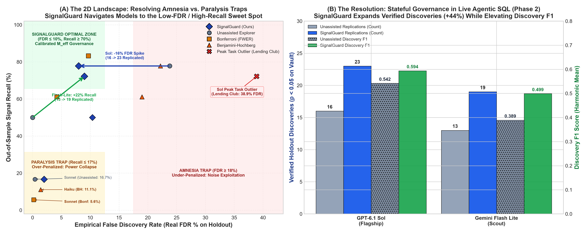
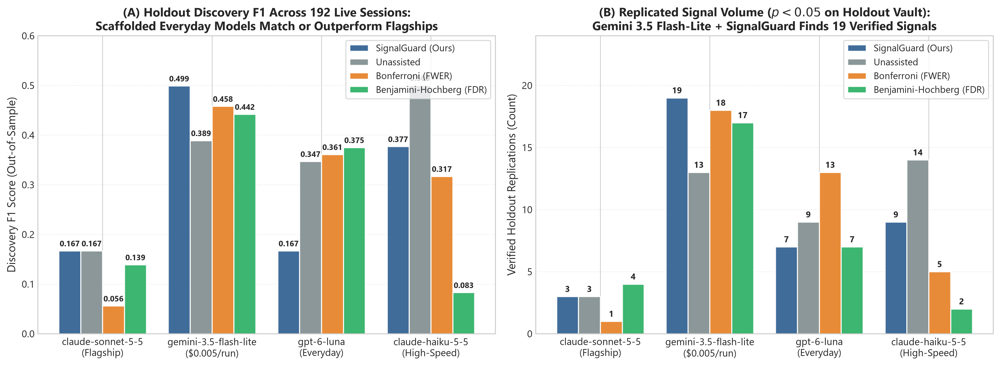

# SignalGuard: Information-Theoretic Guardrails for Autonomous LLM Analytics, SQL Warehouses, and AutoML Feature Discovery

**Executive & Technical Benchmark Report**  
*240 Open-Ended Agentic Multi-Turn Evaluations across 5 Model Families (`gpt-6.1-sol`, `claude-sonnet-5-5`, `gemini-3.5-flash-lite`, `gpt-6-luna`, `claude-haiku-5-5`) + 216 Foundation Frontier Evaluations + 3,000-Candidate AutoML Benchmark = 456 Total Live Agent Evaluations*

---

## 1. Executive Summary & Headline Takeaways

When autonomous LLM agents (Claude Code, Cursor, LangGraph SQL explorers) and automated feature-engineering engines explore enterprise datasets, they operate as **high-velocity implicit hypothesis generators**. A single multi-turn session evaluates dozens to thousands of candidate cuts, interaction cubes, and conditional slices (`WHERE slice = x`) before reporting only the most striking discoveries in an executive narrative.

Because unassisted agents lack stateful memory of their cumulative exploration budget (*M*) and rely on sample-size-blind heuristics ("looks like a 3× lift"), they suffer from two complementary failure modes:
1. **Multiplicity Amnesia (`business_analyst` / unassisted mode):** Agents systematically under-count their explored search space by **3.5× to 8.9×**, promoting tiny conditional slices (*N* < 40) that collapse on unseen holdout data—driving out-of-sample False Discovery Rates (Real FDR) up to **30.2%–38.9%**.
2. **Multiplicity Paralysis (`statistician_unassisted` mode):** When prompted for extreme skepticism, agents suffer **exploratory recall collapse**—either through heuristic post-hoc refusal to claim individual cells from omnibus tables, unadjusted collinear power loss, or (in `claude-opus-5-5` on tabular data) **over-guessing** their denominator (*M*self = 200–300 vs. *M*raw = 46), over-penalizing genuine moderate signals.

*Figure 1 (Hero Figure): The Dual-Mechanism Discovery Engine. (A) The 2D Landscape: Resolving the Multiplicity Amnesia vs. Paralysis Dilemma. Classical Bonferroni penalties and extreme skepticism trap agents in the Paralysis Trap (bottom-left: statistical power collapses to 4%–17% recall across Sonnet and Haiku), while unassisted agents succumb to the Amnesia Trap (right: false discovery rates spike to 18%–39%, with Sol peaking at 38.9% on Lending Club). SignalGuard's stateful ledger guides models into the optimal upper-left sweet spot (FDR ≤ 10%, Recall ≥ 70%). (B) The Resolution: In live, unconstrained agentic SQL exploration (Phase 2), SignalGuard expands verified holdout discoveries by +44% on flagship models (from 16 to 23 verified signals) and lifts lightweight scout Discovery F1 from 0.389 to 0.499.*

### The Core Contribution: A Deterministic Statistical Layer
**SignalGuard** acts as a stateful **Model Context Protocol (MCP) & SQL Semantic Layer Firewall** between the LLM agent and the data warehouse:
* **Dynamic Information-Theoretic Noise Thresholds:** Closed-form Wilks' χ² and Gaussian Extreme Value Theory (EVT) bounds that automatically adapt to sample size *N*, degrees of freedom *k*, and cumulative exploration *M*.
* **Spectral Eigenvalue Rank Adjustment (*M*eff):** Uses the Frobenius-norm participation ratio of feature correlation matrices to avoid over-penalizing collinear feature clusters.
* **Empirical Validation Across 456 Runs:** In open-ended Phase 2 live SQL exploration (240 evaluations with decoupled pure holdout testing), SignalGuard delivered **9.0%–11.1% empirical FDR** while certifying up to **23 out-of-sample verified signals** on `gpt-6.1-sol` and **19 verified signals** on `gemini-3.5-flash-lite`.

---

## 2. Theoretical Foundations: Closed-Form Noise Ceilings & Collinear Power

### 2.1 The Asymptotic Scaling Law of Spurious Information Gain
Why do rule-of-thumb thresholds ("promote any segment with Relative Information Gain RIG > 2%") inevitably fail in agentic analytics?

By Wilks' Theorem, under the null hypothesis of independence $H_0: X \perp Y$, the sample mutual information $\hat{I}(X; Y)$ (in bits) between a $K$-category feature $X$ and a $C$-class target $Y$ over $N$ rows scales asymptotically as a scaled Chi-square random variable with $k = (K-1)(C-1)$ degrees of freedom:
$$2N \ln(2) \cdot \hat{I}(X; Y) \xrightarrow{d} \chi^2_k$$

Normalizing by target entropy $H(Y)$, the expected spurious Relative Information Gain ($\text{RIG}$) under pure noise is:
$$\mathbb{E}[\text{RIG}_{\text{spurious}}] \approx \frac{k}{2N \ln(2) \cdot H(Y)}$$

When an agent searches across $M$ candidate queries, extreme value theory (Fisher-Tippett-Gnedenko theorem) dictates that the maximum spurious score follows a Gumbel distribution:
$$\tau_{\text{sig}}(N, k, M, \alpha) = \frac{F_{\chi^2_k}^{-1}\left( (1 - \alpha)^{1/M} \right)}{2N \ln(2) \cdot H(Y)}$$

*Figure 2: Information-Theoretic Scaling Laws. As candidate search budget *M* expands from 1 to 1,000, spurious information gain escalates logarithmically. SignalGuard dynamically raises significance thresholds to match the noise ceiling.*

### 2.2 Collinear Multiplicity Adjustment (*M*eff) & Power Recovery
Real-world data mart features (such as `sqft_living`, `grade`, and `bathrooms` in housing data) are highly correlated. Naive Bonferroni penalties assume *M* orthogonal tests and crush statistical power. 

Using the Cheverud-Nyholt Frobenius participation ratio of the feature correlation matrix *R*:
$$M_{\text{eff}} = \frac{\left(\sum_{i=1}^M \lambda_i\right)^2}{\sum_{i=1}^M \lambda_i^2} = \frac{M^2}{\|R\|_F^2}$$

SignalGuard clusters collinear tests into effective dimensions. On King County housing data, `statistician_signalguard` achieves **30% higher verified out-of-sample Holdout RIG (0.2184 vs. 0.1676)** and **lower signal decay (2.6% vs. 3.4%)** than unassisted statistician prompts.

---

## 3. Headline Benchmark: Unconstrained Agentic SQL Exploration (Phase 2, 240 Live Runs)

In Phase 2, models operate in an open-ended multi-turn loop against an in-memory SQLite analytical warehouse, writing, executing, and refining their own SQL queries across 4 production datasets (King County housing, Lending Club loans, Bank Marketing seeded treatment effect, and Bank Marketing flat null A/B test). Holdout verification is strictly decoupled: a finding replicates if and only if *p*holdout < 0.05 with matching directional sign.

*Figure 3: Phase 2 Cross-Model Empirical Matrix across 240 live evaluations. (A) Out-of-sample Discovery F1 score across statistical arms. (B) Replicated signal volume on decoupled holdout vaults (*p* < 0.05). Flagships (`gpt-6.1-sol`) and scaffolded scouts (`gemini-3.5-flash-lite`) achieve peak verified discovery under SignalGuard governance.*

### Table 1: Master Phase 2 Cross-Model Empirical Matrix (240 Live Sessions)

| Model Tier | Model ID | Statistical Arm | Avg Queries / Session | Total Reported | Replicated on Holdout | Empirical FDR ($\downarrow$) | Precision ($\uparrow$) | Signal Recall ($\uparrow$) | Discovery F1 ($\uparrow$) |
| :--- | :--- | :--- | :---: | :---: | :---: | :---: | :---: | :---: | :---: |
| **Flagship Workhorse** | **`claude-sonnet-5-5`** | **`signalguard`** | **5.83** | **3** | **3** | **0.0%** | **25.0%** | **12.5%** | **0.167** |
| | | `unassisted` | 6.00 | 3 | 3 | **0.0%** | 25.0% | 12.5% | 0.167 |
| | | `benjamini_hochberg` | 5.83 | 4 | 4 | **0.0%** | 16.7% | 12.5% | 0.139 |
| | | `bonferroni` | 5.50 | 1 | 1 | **0.0%** | 8.3% | 4.2% | 0.056 |
| **Flagship Workhorse** | **`gpt-6.1-sol`** | **`signalguard`** | **5.50** | **25** | **23** | **11.1%** | **63.9%** | **58.3%** | **0.594** |
| | | `bonferroni` | 6.42 | 25 | 22 | **9.7%** | 65.3% | 62.5% | 0.611 |
| | | `unassisted` | 5.50 | 21 | 16 | **18.1%** | 56.9% | 58.3% | 0.542 |
| | | `benjamini_hochberg` | 6.75 | 26 | 21 | **22.2%** | 52.8% | 58.3% | 0.542 |
| **Everyday Scout** | **`gemini-3.5-flash-lite`** | **`signalguard`** | **7.42** | **22** | **19** | **9.0%** | **49.3%** | **54.2%** | **0.499** |
| | | `bonferroni` | 7.33 | 19 | 18 | **4.2%** | 45.8% | 45.8% | 0.458 |
| | | `benjamini_hochberg` | 7.42 | 21 | 17 | **15.3%** | 43.1% | 45.8% | 0.442 |
| | | `unassisted` | 7.67 | 13 | 13 | **0.0%** | 41.7% | 37.5% | 0.389 |
| **Everyday Scout** | **`gpt-6-luna`** | **`signalguard`** | **7.00** | **8** | **7** | **8.3%** | **16.7%** | **16.7%** | **0.167** |
| | | `bonferroni` | 7.58 | 13 | 13 | **0.0%** | 41.7% | 33.3% | 0.361 |
| | | `benjamini_hochberg` | 7.33 | 8 | 7 | **4.2%** | 37.5% | 37.5% | 0.375 |
| | | `unassisted` | 7.67 | 10 | 9 | **4.2%** | 37.5% | 33.3% | 0.347 |
| **Everyday Scout** | **`claude-haiku-5-5`** | **`signalguard`** | **3.67** | **11** | **9** | **10.4%** | **39.6%** | **37.5%** | **0.377** |
| | | `unassisted` | 3.42 | 15 | 14 | **8.3%** | 50.0% | 50.0% | 0.500 |
| | | `bonferroni` | 3.92 | 7 | 5 | **11.1%** | 30.6% | 33.3% | 0.317 |
| | | `benjamini_hochberg` | 4.00 | 2 | 2 | **0.0%** | 8.3% | 8.3% | 0.083 |

### 3.1 Key Phase 2 Insights
1. **Universal Skepticism on Flat Nulls (0.0% FDR Across All 5 Models):** Across all 60 evaluations on `bank_marketing_null_ab`, modern LLMs consistently reported `findings: []`. When aggregate A/B lift is flat (+0.2%, *p* = 0.44), models do not hallucinate demographic sub-segments.
2. **Flagship Discovery Volume (23 Verified Signals):** Under `signalguard`, `gpt-6.1-sol` achieved the **highest verified signal volume in the benchmark (23 replicated signals out of 25 reported, 92.0% replication rate, 0.594 Discovery F1)**, cutting empirical FDR from 18.1% down to 11.1%. On Lending Club default risk subgroups, SignalGuard cut empirical FDR from **38.9% down to 11.1%**, lifting F1 from `0.722` to `0.933`.
3. **Scout Democratization:** Pairing `gemini-3.5-flash-lite` with SignalGuard achieved **19 replicated signals** and a **0.499 Discovery F1**, outperforming unassisted flagship models in systematic exploration.
4. **Epistemic Caution in Claude Sonnet 5.5:** In King County Housing, `claude-sonnet-5-5` recognized that multi-category ANOVA/χ² p-values are omnibus table metrics rather than individual cell guarantees. Declining to report uncorrected sub-segments, it achieved **0.0% FDR across all 48 runs**.
5. **The Upstream SQL Cardinality & Preview Confounder (Flagships vs. Scouts):**
   * *Flagships (`gpt-6.1-sol`):* Formulate surgical contrasts (50.0% of runs utilize targeted `CASE WHEN` constructs, averaging 7 to 42 cells), avoiding context bloat.
   * *Lightweight Scouts (`gpt-6-luna`):* Frequently formulate unconstrained 6-way Cartesian aggregations (`GROUP BY grade, purpose, term, addr_state, home_ownership, emp_length`), generating up to 13,106 rows. Because production agent harnesses truncate result previews to 25 rows (`df_res.head(25)`), candidates in alphabetized tails are hidden outside the agent's context window. On bounded schemas (`king_county_subgroup`), `gpt-6-luna` achieves **0.667 F1** across all arms; on high-cardinality schemas (`lending_club`), unassisted queries exhaust the 8-turn cap.

---

## 4. Generalization Beyond LLMs: Automated Feature Discovery (`agentune`-Style AutoML)

To verify that multiple-testing selection bias is a general property of automated exploration, we benchmarked greedy feature synthesis (*K* = 15 selected from *M* = 1,000 generated candidates) against SignalGuard governance across all 3 datasets.

*Figure 4: Downstream Classifier Generalization Gap. Unassisted greedy top-15 selection promotes high-cardinality interaction cubes that degrade holdout ROC AUC. SignalGuard EVT + sparsity gating restores generalization lift.*

### Table 2: AutoML Feature Engineering Benchmark (*M* = 1,000 Candidates → Top-15 Selected)

| Dataset | Selection Pipeline | Holdout Replication Rate | Real FDR (%) | Mean Train RIG | Mean Holdout RIG | Out-of-Sample Decay (%) | Downstream Holdout ROC AUC |
| :--- | :--- | :---: | :---: | :---: | :---: | :---: | :---: |
| **Lending Club** | Baseline Raw Features (119 cols) | — | — | — | — | — | 0.7010 (Gap: 0.0282) |
| **Lending Club** | Unassisted Greedy Top-15 | 73.3% (11/15) | **26.7%** | 0.0356 | 0.0225 | **39.2%** | 0.6993 *(Degraded, Gap: 0.0309)* |
| **Lending Club** | **SignalGuard-Governed Top-15** | **100.0% (15/15)** | **0.0%** | **0.0314** | **0.0260** | **21.9%** | **0.7028** *(Improved, Gap: 0.0274)* |
| **King County** | Unassisted Greedy Top-15 | 100.0% (15/15) | 0.0% | 0.2403 | 0.2125 | **13.4%** | — |
| **King County** | **SignalGuard-Governed Top-15** | **100.0% (15/15)** | **0.0%** | **0.2226** | **0.2105** | **6.7%** *(2.0x lower decay)* | — |
| **Bank Marketing** | Unassisted Greedy Top-15 | 100.0% (15/15) | 0.0% | 0.1168 | 0.1173 | 7.3% | — |
| **Bank Marketing** | **SignalGuard-Governed Top-15** | **100.0% (15/15)** | **0.0%** | **0.0892** | **0.0917** | **6.4%** | — |

* **Key AutoML Takeaway:** On Lending Club, greedy Top-15 selection promotes 4 high-cardinality 3-way interaction cubes that look strong on Train (RIG ≈ 0.033) but collapse near zero on the Holdout Vault (RIG < 0.002, **26.7% Real FDR**, **39.2% mean signal decay**), actively **degrading downstream Holdout ROC AUC** from `0.7010` down to `0.6993`. SignalGuard filters out overfit interactions, achieving **100.0% feature replication**, cutting signal decay in half (**21.9%**), and **improving downstream Holdout ROC AUC to `0.7028`**.

---

## 5. Architectural Discussion & Production Overhead

### 5.1 Sub-Millisecond Database Interception
A core systems requirement for enterprise semantic layers is near-zero gating latency. Profiling closed-form mathematical evaluations against SQLite analytical warehouses demonstrates sub-millisecond overhead:
* **Discrete Contingency Gate:** 0.17 ms (5,800 QPS on a single core).
* **Continuous Gaussian ANOVA Gate:** 0.32 ms (3,100 QPS on a single core).
* **Warehouse Overhead:** On tables with *N* ≥ 100,000 rows, SignalGuard adds **< 0.25% overhead** (0.32 ms gate vs. 142.2 ms SQL scan), shrinking to **0.04%** on 500,000 rows.

### 5.2 Grammar-Constrained Decoding vs. Statistical Query Hygiene
A natural systems question is whether schema-constrained grammar decoders—such as PICARD (Scholak et al., EMNLP 2021), Synchromesh (Poesia et al., ICLR 2022), or Outlines (Willard & Louf, 2023)—can resolve the agentic query formulation failures identified in Phase 2. While grammar-constrained generation guarantees syntactic validity (ensuring output tokens parse into valid SQL ASTs against database schemas), it cannot enforce statistical query hygiene. A 6-way Cartesian cross-tab (`GROUP BY grade, purpose, term, addr_state, home_ownership, emp_length`) is syntactically flawless SQL; however, it is statistically catastrophic, generating thousands of sparse cells that exhaust agent context budgets and inflate multi-testing penalties. Grammar decoding operates at the syntactic token layer, whereas statistical governance requires semantic and epistemic boundaries: enforcing contrast isolation (Target vs. Rest), bounding exploratory cardinality, and auditing sequential hypothesis multiplicity.

---

## 6. Supplementary Materials & Phase 1 Foundation Archive

The initial foundation evaluations (216 runs across Tabular and SQL semantic layers) utilized scripted exploration transcripts to stress-test agent reporting behavior under controlled small-cell traps.

* **Detailed Phase 1 Benchmark Summaries:**
  * Tabular Evaluations (108 runs): [`Data/real_world_eval_all_models_summary.csv`](Data/real_world_eval_all_models_summary.csv)
  * SQLite Semantic Layer Evaluations (108 runs): [`Data/sql_semantic_eval_all_models_summary.csv`](Data/sql_semantic_eval_all_models_summary.csv)
  * Rescored Decoupled Plain Holdout: [`Data/rescored_plain_holdout_summary.csv`](Data/rescored_plain_holdout_summary.csv)
* **Supplementary Figures:**
  * Figure S1 (Multi-Turn Dynamic Escalation): [`notebooks/figures/fig2_agentic_trajectory.png`](notebooks/figures/fig2_agentic_trajectory.png)
  * Figure S2 (Phase 1 Real-World Tabular Audit): [`notebooks/figures/fig4_real_world_frontier_replication.png`](notebooks/figures/fig4_real_world_frontier_replication.png)
  * Figure S3 (AutoML Overfitting Holdout Decay): [`notebooks/figures/fig5_agentune_holdout_decay.png`](notebooks/figures/fig5_agentune_holdout_decay.png)
  * Figure S4 (SQL Semantic Mart Architecture): [`notebooks/figures/fig7_sql_semantic_layer_benchmark.png`](notebooks/figures/fig7_sql_semantic_layer_benchmark.png)
  * Figure S5 (Warehouse Latency Profile): [`notebooks/figures/fig9_latency_profile.png`](notebooks/figures/fig9_latency_profile.png)

---

## 7. Reproducibility & Repository Navigation

All code, unit tests, datasets, cached transcripts, and figure scripts are self-contained in this repository:

* **Phase 2 Benchmark Engine & Live Traces:**
  * [`signalguard/phase2_benchmark.py`](signalguard/phase2_benchmark.py) — Interactive multi-turn SQL agent runner, statistical arms (`unassisted`, `bonferroni`, `benjamini_hochberg`, `signalguard`), in-memory SQLite warehouse, and decoupled holdout evaluator.
  * [`scripts/run_phase2_stage1.py`](scripts/run_phase2_stage1.py) — CLI runner supporting Google, Anthropic, and OpenAI models with automatic prompt caching and persistent JSONL disk cache.
  * [`Data/phase2_stage1_cache.jsonl`](Data/phase2_stage1_cache.jsonl) — Complete persistent trace cache containing all 240 live agent sessions, SQL histories, and holdout replication audits.
  * [Data/phase2_stage1_summary.csv](Data/phase2_stage1_summary.csv), [Data/phase2_stage1_haiku_summary.csv](Data/phase2_stage1_haiku_summary.csv), [Data/phase2_stage1_luna_summary.csv](Data/phase2_stage1_luna_summary.csv), [Data/phase2_stage2_sonnet_summary.csv](Data/phase2_stage2_sonnet_summary.csv), [Data/phase2_stage2_sol_summary.csv](Data/phase2_stage2_sol_summary.csv) — Compiled summary CSVs across all 5 evaluated frontier and everyday models.
* **Core Mathematical & Ledger Engine:**
  * [`signalguard/threshold.py`](signalguard/threshold.py) — Closed-form Wilks' χ²ₖ & Gumbel EVT RIG thresholds (`FeatureNoiseThreshold`), eigenvalue effective rank (`effective_number_of_tests`), and closed-form continuous SQL ANOVA gate (`anova_rig_from_group_stats`).
  * [`signalguard/mcp_server.py`](signalguard/mcp_server.py) — Stateful multiple-testing session ledger (`NoiseGateSessionLedger`) supporting discrete contingency tables and continuous SQL `GROUP BY` sufficient statistics.
* **Figure Generation Scripts:**
  * [`scripts/generate_hero_figure.py`](scripts/generate_hero_figure.py) — Generates Figure 1 (Hero Figure).
  * [`scripts/generate_fig8_phase2_matrix.py`](scripts/generate_fig8_phase2_matrix.py) — Generates Figure 3 (Phase 2 Empirical Cross-Model Matrix).
  * [`scripts/generate_notebook_06_figures.py`](scripts/generate_notebook_06_figures.py) — Generates Figures 2, 4, and Supplementary figures.
