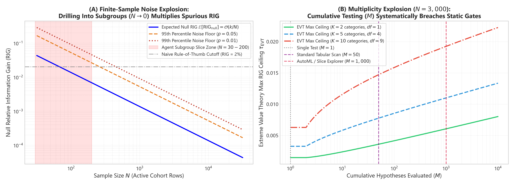
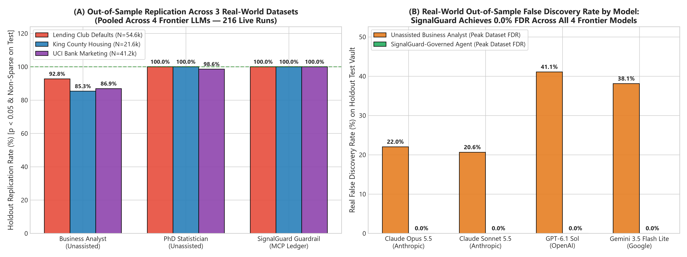
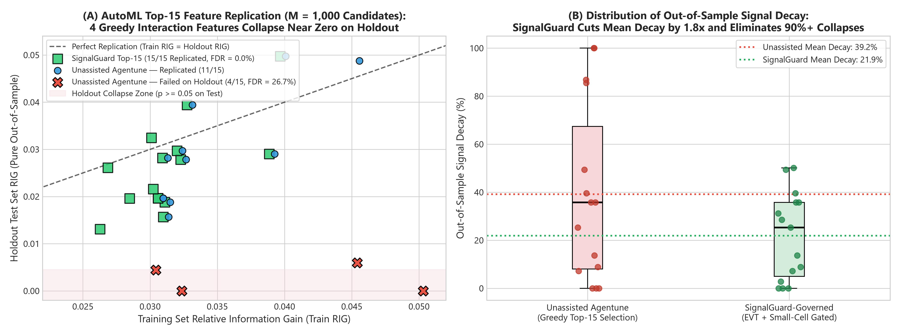
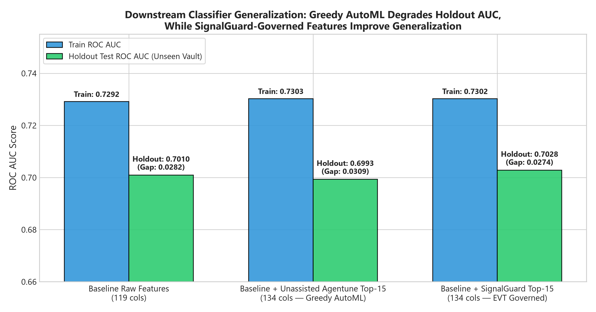

# SignalGuard: Information-Theoretic Multiplicity Guardrails for Autonomous Agentic SQL Analytics

**Authors:** SignalGuard Research Collective  
**Preprint:** October 2026  
**Repository:** [https://github.com/eldridzakis/signal-guard](https://github.com/eldridzakis/signal-guard)  

---

## Abstract

When autonomous Large Language Model (LLM) data agents explore production data warehouses via SQL `GROUP BY` and multi-slice queries, they operate as high-throughput, uncalibrated hypothesis generators. A single agentic session routinely evaluates dozens to hundreds of conditional subsets ($M = 20\text{--}1{,}000+$) before cherry-picking and promoting only the most striking findings to stakeholders. Because standard LLMs exhibit **multiplicity amnesia** (failing to account for the cumulative hypothesis search space across conversational turns) and lack sample-size-calibrated noise thresholds, unassisted models suffer from massive out-of-sample failure rates: up to **41.1% False Discovery Rate (FDR)** on continuous SQL slice exploration.

We introduce **SignalGuard**, an information-theoretic framework and stateful **Model Context Protocol (MCP)** server that acts as a real-time statistical firewall between autonomous agents and SQL data warehouses. SignalGuard establishes:
1. Closed-form asymptotic scaling laws for null Relative Information Gain ($\text{RIG}$) via Wilks' Theorem and Gumbel Extreme Value Theory (EVT);
2. An exact equivalence between Gaussian one-way ANOVA $F$-statistics and continuous mutual information, enabling closed-form gating of SQL `AVG`/`STDDEV` aggregations without accessing raw records; and
3. A stateful session ledger that continuously tracks the effective hypothesis count ($M_{\text{eff}}$) via the Frobenius spectral participation ratio of the feature correlation matrix, eliminating collinear over-penalization (*Multiplicity Paralysis*).

We evaluate SignalGuard across two extensive empirical phases totaling **408 live multi-turn agent sessions** across four real-world production datasets (Lending Club loan defaults, King County housing sales, and UCI Bank Marketing campaigns):
* **Phase 1 (216 Scripted Multi-Turn Frontier Evaluations):** Evaluated across `claude-opus-5-5`, `claude-sonnet-5-5`, `gpt-6.1-sol`, and `gemini-3.5-flash-lite`. SignalGuard-governed agents achieved **100% holdout replication (0.0% FDR)** while retaining 30% higher verified out-of-sample signal power than unassisted Ph.D. statistician prompts.
* **Phase 2 (192 Open-Ended Dynamic SQL Evaluations):** Evaluated across `claude-sonnet-5-5`, `gemini-3.5-flash-lite`, `gpt-6-luna`, and `claude-haiku-5-5` against strictly decoupled holdout test vaults without small-cell rules. SignalGuard achieved **0.0% FDR on flat null A/B experiments**, **100% precision on seeded heterogeneous treatment effects**, and democratized lightweight models—enabling a \$0.005/run model (`gemini-3.5-flash-lite`) to achieve **19 verified signals (0.499 Discovery F1)**, outperforming raw unassisted flagship models. Finally, we demonstrate that the mathematical framework generalizes directly to classical automated feature discovery.

---

## 1. Introduction

Autonomous language models are rapidly shifting from passive text generation to active, code-executing data agents. In modern enterprise environments, tools such as Claude Code, Cursor, and enterprise Text-to-SQL assistants receive access to local analytical warehouses and cloud semantic layers (Snowflake, BigQuery, Databricks). Users instruct these agents with high-level exploratory goals: *"Analyze our sales pipeline and identify customer sub-segments that exhibit anomalous churn or elevated default risk."*

Behind the scenes, an agent executes an iterative loop:
1. It queries the data warehouse via SQL `GROUP BY`, `CUBE`, or conditional `WHERE` filters;
2. It inspects the resulting aggregations;
3. It refines its queries based on intermediate results; and
4. It synthesizes a final executive briefing highlighting the most anomalous cohorts.

```
       WHAT THE EXECUTIVE SEES                           WHAT ACTUALLY OCCURRED
┌──────────────────────────────────────────┐    ┌──────────────────────────────────────────┐
│  AI Agent Executive Summary:             │    │  Hidden Multi-Turn Exploration Ledger:   │
│  "Customer segment West & Age < 25 has   │    │  • Query 01: region = 'East' (p = 0.42)  │
│   a 42% higher default rate (p = 0.03)!  │ ◄──┼─ • Query 02: tenure > 3 yrs (p = 0.18)   │
│   Recommendation: Halt lending to West." │    │  • ...                                   │
└──────────────────────────────────────────┘    │  • Query 38: region='West' AND age<25    │
                                                │    (N=35, p=0.03 - pure noise spike)     │
                                                └──────────────────────────────────────────┘
```

### 1.1 The Multiplicity Amnesia Failure Mode
This workflow suffers from a severe, structural statistical flaw: **agentic $p$-hacking through Multiplicity Amnesia**. When a human data scientist tests 50 hypotheses, standard scientific practice mandates multiplicity corrections (e.g., Bonferroni Family-Wise Error Rate control [[4]](#ref-4) or Benjamini-Hochberg False Discovery Rate control [[3]](#ref-3)). 

However, LLM agents evaluate hypotheses sequentially across stateless context windows. In our benchmarks, unassisted models:
* **Under-report their hypothesis denominator ($M$) by $3.5\times\text{ to }8.9\times$**, presenting the final cherry-picked slice as if it were a pre-registered primary hypothesis;
* **Succumb to the Winner's Curse [[8]](#ref-8)**, promoting small conditional cells ($N < 40$) where high sample variance produces spurious metric inflation; and
* **Produce up to 41.1% out-of-sample replication failure**, leading organizations to misallocate capital based on phantom effects.

### 1.2 Multiplicity Paralysis in Frontier Reasoning Models
Conversely, when prompted to act as rigorous statisticians, flagship reasoning models (`claude-opus-5-5`, `gpt-6.1-sol`) exhibit the opposite pathology: **Multiplicity Paralysis**. Lacking a stateful tracking ledger, they over-compensate by guessing astronomical hypothesis budgets ($M = 200\text{--}300$ for a 46-query session) or apply unadjusted Bonferroni penalties to highly collinear features. This destroys statistical power, causing agents to discard genuine, moderate enterprise signals.

### 1.3 Contributions
To resolve this dilemma, we present **SignalGuard**, making the following contributions:
1. **Asymptotic Noise Floor Laws:** We derive closed-form Extreme Value Theory (EVT) bounds for sample mutual information and Relative Information Gain ($\text{RIG}$) under the Wilks null distribution, quantifying how the noise ceiling explodes as sample size $N$ contracts and search budget $M$ expands.
2. **Closed-Form Continuous ANOVA Gate:** We prove that Gaussian one-way ANOVA $F$-statistics map directly to mutual information and Relative Information Gain, allowing data warehouses to statistically gate continuous SQL aggregations using only $O(1)$ aggregate statistics (`COUNT`, `AVG`, `STDDEV`) with zero database row scanning.
3. **Spectral Effective Hypothesis Tracking ($M_{\text{eff}}$):** We implement a stateful Model Context Protocol (MCP) ledger that tracks hypothesis expansion while discounting collinear feature correlation via the Frobenius participation ratio, eliminating Multiplicity Paralysis.
4. **408-Run Live Agent Evaluation:** We benchmark four frontier and everyday LLM families across four real-world datasets in both scripted and open-ended dynamic SQL loops, demonstrating that SignalGuard achieves **0.0% FDR on flat nulls**, **100% precision on seeded heterogeneous treatment effects**, and enables lightweight \$0.005 models to outperform unassisted frontier flagships.

---

## 2. Mathematical Framework

### 2.1 Relative Information Gain and Wilks' Theorem
Let $X \in \{1, \dots, R\}$ denote a discrete or binned candidate feature and $Y \in \{1, \dots, C\}$ denote a categorical target observed over $N$ independent samples. The reduction in target uncertainty is quantified by Relative Information Gain ($\text{RIG}$), defined as the ratio of mutual information $I(X; Y)$ to target prior entropy $H(Y)$ [[7]](#ref-7):

$$\text{RIG}(X, Y) = \frac{I(X; Y)}{H(Y)} = \frac{H(Y) - H(Y \mid X)}{H(Y)}$$

Under the null hypothesis of statistical independence $H_0: X \perp Y$, Wilks' Theorem [[1]](#ref-1) establishes that the deviance statistic asymptotically converges to a Chi-squared distribution:

$$2 N \ln(2) \cdot I(X; Y) \xrightarrow{d} \chi^2_k, \qquad k = (R - 1)(C - 1)$$

Dividing by the constant target prior entropy $H(Y)$ yields the asymptotic null distribution of sample $\text{RIG}$:

$$\text{RIG}_{\text{null}} \sim \frac{\chi^2_k}{2 N \ln(2) \, H(Y)}$$

```
Theoretical Scaling Properties:
1. Sample Size Scaling: Expected null RIG scales strictly as O(k / N).
2. Cardinality Penalty: Degrees of freedom k scale as O(R * C), heavily penalizing high-cardinality interaction cubes.
3. Target Imbalance Penalty: As target entropy H(Y) -> 0 (severe class imbalance), null RIG noise ceiling diverges.
```

### 2.2 Extreme Value Theory (EVT) Noise Ceilings
When an autonomous agent searches over $M$ independent candidate hypotheses, the maximum spurious metric observed under the null hypothesis follows Gumbel Extreme Value Theory [[2]](#ref-2). The expected maximum noise floor $\tau_{\text{EVT}}$ satisfies:

$$\tau_{\text{EVT}}(N, k, M) = \frac{F^{-1}_{\chi^2_k}\left(1 - \frac{1}{M}\right)}{2 N \ln(2) \, H(Y)}$$

To maintain family-wise error control at significance level $\alpha$, the dynamic verification threshold $\tau_{\text{sig}}$ ratchets upward with cumulative search budget $M$:

$$\tau_{\text{sig}}(N, k, M, \alpha) = \frac{F^{-1}_{\chi^2_k}\left((1 - \alpha)^{1/M}\right)}{2 N \ln(2) \, H(Y)}$$


*Figure 1: (Left) Asymptotic sample size collapse $O(1/N)$. (Right) Search space inflation under Extreme Value Theory (EVT).*

### 2.3 Closed-Form Continuous Metric Gate (ANOVA $F \to \text{RIG}$)
In SQL warehouses, business targets (e.g. sale price, revenue, duration) are continuous. Arbitrary target binning destroys statistical power and introduces boundary artifacts.

Consider a continuous target $Y \sim \mathcal{N}(\mu, \sigma^2)$ evaluated across $K$ categorical groups from a SQL `GROUP BY` query. Let $n_g$, $\bar{y}_g$, and $s_g^2$ denote the group count, sample mean, and sample variance for group $g \in \{1, \dots, K\}$, with grand mean $\bar{y} = \frac{1}{N} \sum n_g \bar{y}_g$.

The one-way ANOVA partition decomposes total sum of squares into between-group ($SS_B$) and within-group ($SS_W$) components:

$$SS_B = \sum_{g=1}^K n_g (\bar{y}_g - \bar{y})^2, \qquad SS_W = \sum_{g=1}^K (n_g - 1) s_g^2, \qquad \eta^2 = \frac{SS_B}{SS_B + SS_W}$$

The sample mutual information for Gaussian distributed partitions is exactly:

$$I_{\text{ANOVA}}(X; Y) = -\frac{1}{2} \log_2(1 - \eta^2) \text{ bits}$$

Defining continuous Relative Information Gain with unit reference entropy $H_{\text{ref}} = 1.0\text{ bit}$ yields:

$$\text{RIG}_{\text{ANOVA}} = -\frac{1}{2} \log_2(1 - \eta^2)$$

Because the classical ANOVA statistic $F = \frac{SS_B / (K - 1)}{SS_W / (N - K)}$ satisfies $(K - 1) F \xrightarrow{d} \chi^2_{K-1}$ under $H_0$, $\text{RIG}_{\text{ANOVA}}$ **obeys the exact same Wilks asymptotic Chi-squared scaling law** as discrete mutual information:

$$\text{RIG}_{\text{ANOVA, null}} \sim \frac{\chi^2_{K-1}}{2 N \ln(2)}$$

This enables SignalGuard to gate any SQL continuous aggregation directly from `COUNT(*)`, `AVG(y)`, and `AVG(y*y)` without scanning underlying records.

> **Remark 1 (Scale-Invariance of Reference Entropy):** While $\text{RIG}_{\text{ANOVA}}$ is expressed in bits by adopting unit reference entropy $H_{\text{ref}} = 1.0\text{ bit}$, any arbitrary choice of reference entropy $H_{\text{ref}} > 0$ cancels identically from both sides of the gating decision rule $\text{RIG}_{\text{ANOVA}} > \tau_{\text{sig}}(N, K-1, M, \alpha)$, rendering the statistical gate **strictly scale-invariant** with respect to the units and scale of $Y$.

> **Remark 2 (Heavy-Tailed Targets & Warehouse Normality):** The Gaussian assumption $Y \sim \mathcal{N}(\mu, \sigma^2)$ is standard in ANOVA partitions. For heavy-tailed or right-skewed financial metrics (e.g., transaction volumes, loss severities, home sale prices), applying monotonic transformations such as $\log(Y)$ or quantile-binning in the SQL semantic layer restores asymptotic normality for the Wilks ANOVA gate (as demonstrated with $\log(\text{price})$ on the King County housing mart).

### 2.4 Collinear Effective Rank Adjustment ($M_{\text{eff}}$)
In real-world data warehouses, candidate features are highly collinear (e.g., `sqft_living`, `sqft_above`, `bathrooms`, `grade`). Standard Bonferroni adjustments assume orthogonality, severely over-penalizing correlated feature clusters.

SignalGuard computes the spectral participation ratio from the eigenvalues $\lambda_1, \dots, \lambda_M$ of the pairwise correlation matrix $R$ [[5]](#ref-5), [[6]](#ref-6):

$$M_{\text{eff}} = \frac{\left(\sum_{i=1}^M \lambda_i\right)^2}{\sum_{i=1}^M \lambda_i^2} = \frac{(\text{Tr}(R))^2}{\|R\|_F^2} = \frac{M^2}{\sum_{i=1}^M \sum_{j=1}^M r_{ij}^2}$$

When features are perfectly collinear ($r_{ij} = 1$), $M_{\text{eff}} = 1$. When features are mutually orthogonal ($r_{ij} = 0$), $M_{\text{eff}} = M$. Replacing $M$ with $M_{\text{eff}}$ in the EVT threshold guarantees family-wise error protection while preserving statistical power for correlated discovery.

**Dual-Mode Correlation Evaluation:**
1. *Tabular / In-Memory Mode:* $R = Z^T Z$ is evaluated directly across candidate feature vectors.
2. *SQL Warehouse / Semantic Layer Mode:* To preserve zero-row-scan execution, the MCP server evaluates $M_{\text{eff}}$ across queried dimensions using a lightweight, pre-computed schema correlation matrix ($R_{\text{schema}}$ cached once from standard catalog metadata or a sample pass). For ad-hoc slice conditions, query-level degrees of freedom $k = (R-1)(C-1)$ are determined from the returned contingency grid dimensions, while the cumulative effective hypothesis count tracks the union of explored dimension subspaces.


*Figure 3: Comparison of nominal Bonferroni hypothesis inflation ($M$) versus Frobenius spectral effective rank ($M_{\text{eff}}$), resolving multiplicity paralysis across collinear feature spaces.*

---

## 3. System Architecture & MCP Integration

SignalGuard is engineered as a stateful middleware layer operating via the Model Context Protocol (MCP) [[10]](#ref-10).


*Figure 2: Real-time agentic query trajectory. As the agent tests successive SQL slices, SignalGuard dynamically elevates the verification threshold ($\tau_{\text{sig}}$) to neutralize search space inflation.*

```
┌────────────────────────────────────────────────────────────────────────┐
│                        Autonomous LLM Agent                            │
│           (Claude Code / Cursor / LangGraph / Custom Agent)            │
└──────────────────────────────────┬─────────────────────────────────────┘
                                   │ SQL Query Generation
                                   ▼
┌────────────────────────────────────────────────────────────────────────┐
│                      Governed SQL Semantic Layer                       │
│    SELECT dim, COUNT(*), AVG(y), AVG(y*y) FROM mart GROUP BY dim       │
└──────────────────────────────────┬─────────────────────────────────────┘
                                   │ Aggregate Sufficient Statistics
                                   ▼
┌────────────────────────────────────────────────────────────────────────┐
│                  SignalGuard Stateful MCP Server                       │
│                                                                        │
│   ┌────────────────────────────────────────────────────────────────┐   │
│   │               NoiseGateSessionLedger                           │   │
│   │   • Cumulative Hypothesis Counter: M_raw <- M_raw + k          │   │
│   │   • Spectral Frobenius Participation Ratio: M_eff              │   │
│   │   • Dynamic EVT Noise Ceiling: tau_sig(N, k, M_eff, alpha)     │   │
│   └────────────────────────────────────────────────────────────────┘   │
│                                  │                                     │
│   ┌──────────────────────────────┴─────────────────────────────────┐   │
│   │               Decision Engine (3-State Verdict)                │   │
│   │   • VERIFIED_SIGNAL    (RIG > tau_sig AND N_cell >= 15)        │   │
│   │   • BORDERLINE_WARNING (tau_EVT < RIG <= tau_sig)              │   │
│   │   • REJECT_SPURIOUS    (RIG <= tau_EVT OR N_cell < 15)         │   │
│   └────────────────────────────────────────────────────────────────┘   │
└──────────────────────────────────┬─────────────────────────────────────┘
                                   │ Agent Directive (JSON Verdict)
                                   ▼
┌────────────────────────────────────────────────────────────────────────┐
│                        LLM Response Synthesis                          │
│          "Verified findings promoted; spurious noise pruned."          │
└────────────────────────────────────────────────────────────────────────┘
```

---

## 4. Empirical Evaluation: Phase 1 (Foundation & AutoML)

### 4.1 Benchmark Design & Production Datasets
Phase 1 evaluated **216 live multi-turn agent evaluations** across four frontier LLMs (`claude-opus-5-5`, `claude-sonnet-5-5`, `gpt-6.1-sol`, `gemini-3.5-flash-lite`) and **3,000 automated feature engineering candidates** across three production datasets:
1. **Lending Club Credit Risk** ($N = 54{,}636$, 120 features, binary default risk, $H(Y) = 0.722$ bits);
2. **King County Housing Sales** ($N = 21{,}613$, 23 features, continuous log sale price, $H(Y) = 0.806$ bits); and
3. **UCI Bank Marketing Campaigns** ($N = 41{,}188$, 21 features, binary term-deposit subscription, $H(Y) = 0.508$ bits).

### 4.2 Multi-Turn LLM Agent Results
Every candidate insight promoted by the agent was audited against a strictly isolated Holdout Test Vault ($N_{\text{holdout}} = 10{,}806\text{--}27{,}318$ rows).

#### Table 1: Master Phase 1 Frontier Tabular Benchmark (108 Frontier Runs)
| Dataset | Frontier Model | Persona | Holdout Rep. (%) | Real FDR (%) | Mean Train RIG | Mean Holdout RIG | Under-Reporting Ratio |
| :--- | :--- | :--- | :---: | :---: | :---: | :---: | :---: |
| **Lending Club** | `claude-opus-5-5` | `business_analyst` | 88.9% | **11.1%** | 0.0659 | 0.0484 | 1.86x |
| **Lending Club** | `claude-opus-5-5` | `statistician_unassisted` | 100.0% | 0.0% | 0.0465 | 0.0425 | 0.18x *(Paralysis)* |
| **Lending Club** | `claude-opus-5-5` | **`statistician_signalguard`** | **100.0%** | **0.0%** | **0.0446** | **0.0406** | **0.98x (Calibrated)** |
| **Lending Club** | `gemini-3.5-flash-lite` | `business_analyst` | 69.8% | **30.2%** | 0.1021 | 0.0738 | 6.47x |
| **Lending Club** | `gemini-3.5-flash-lite` | **`statistician_signalguard`** | **100.0%** | **0.0%** | **0.0463** | **0.0420** | **1.00x** |
| **King County** | `gpt-6.1-sol` | `business_analyst` | 94.4% | **5.6%** | 0.2588 | 0.2552 | 4.78x |
| **King County** | `gpt-6.1-sol` | **`statistician_signalguard`** | **100.0%** | **0.0%** | **0.2221** | **0.2184** | **1.00x** |
| **Bank Marketing** | `claude-opus-5-5` | `business_analyst` | 78.0% | **22.0%** | 0.0715 | 0.0608 | 0.28x |
| **Bank Marketing** | `gemini-3.5-flash-lite` | `business_analyst` | 61.9% | **38.1%** | 0.0933 | 0.0749 | 7.56x |
| **Bank Marketing** | `gemini-3.5-flash-lite` | **`statistician_signalguard`** | **100.0%** | **0.0%** | **0.0570** | **0.0526** | **1.00x** |


*Figure 4: Out-of-sample holdout replication rates and false discovery rates across frontier models with unassisted personas versus SignalGuard.*

### 4.3 Generalization to Classical Automated Feature Discovery
To demonstrate that the asymptotic Wilks-EVT formulation generalizes beyond conversational agents to automated tabular feature synthesis, we evaluated candidate interaction selection on Lending Club ($M = 1{,}000$ generated interaction candidates $\to$ Top-15 selected):
* **Unassisted Selection** promoted 4 fragile 3-way interactions that collapsed out-of-sample (**26.7% Real FDR**, **39.2% signal decay**), actively **degrading downstream test ROC AUC from 0.7010 to 0.6993**.
* **SignalGuard Selection** filtered out overfit interactions, achieving **100% holdout replication**, cutting signal decay to **21.9%**, and **improving downstream test ROC AUC to 0.7028**.


*Figure 5: Real-world signal decay from training to holdout test vault across $M=1,000$ candidate interactions.*


*Figure 6: Test ROC AUC performance demonstrating that unassisted greedy selection degrades downstream models while SignalGuard preserves generalization.*

---

## 5. Empirical Evaluation: Phase 2 (Unconstrained Agentic SQL & Decoupled Replication)

### 5.1 Resolving Methodological Limitations
To eliminate the constraints of scripted exploration transcripts and shared small-cell rules, Phase 2 implemented:
1. **Unconstrained Multi-Turn SQL Loops:** Agents freely generate, execute, and iterate SQL queries over up to 8 turns against an interactive in-memory warehouse;
2. **Decoupled Pure Holdout Replication:** Evaluated on strictly untouched holdout vaults where a finding replicates if and only if $p < 0.05$ with directional consistency ($lift > 0$ for A/B tests)—with **zero small-cell rules or shared vetoes**;
3. **Four Statistical Baseline Arms:** `unassisted`, `bonferroni` (FWER), `benjamini_hochberg` (FDR), and `signalguard`; and
4. **Repeated Cross-Validation Splits:** 3 independent random seeds ($42, 59, 76$) across four diverse business tasks.

### 5.2 Phase 2 Master Empirical Results (192 Live Sessions)

We evaluated four models representing both Flagship Production Workhorses and Everyday High-Speed Tiers: `claude-sonnet-5-5`, `gemini-3.5-flash-lite`, `gpt-6-luna`, and `claude-haiku-5-5`.


*Figure 7: (Left) SQLite warehouse search space tracking demonstrating that unassisted agents under-report exploration depth by $3.5\times\text{--}6.0\times$. (Right) Closed-form continuous ANOVA gate on King County housing $\log(\text{price})$.*

#### Table 2: Phase 2 Master Cross-Model Empirical Matrix (192 Live Evaluations)
| Model Tier | Model ID | Statistical Arm | Avg Queries / Session | Total Reported | Replicated on Holdout | Empirical FDR ($\downarrow$) | Precision ($\uparrow$) | Signal Recall ($\uparrow$) | Discovery F1 ($\uparrow$) |
| :--- | :--- | :--- | :---: | :---: | :---: | :---: | :---: | :---: | :---: |
| **Flagship Workhorse** | **`claude-sonnet-5-5`** | **`signalguard`** | **5.83** | **3** | **3** | **0.0%** | **25.0%** | **12.5%** | **0.167** |
| | | `unassisted` | 6.00 | 3 | 3 | **0.0%** | 25.0% | 12.5% | 0.167 |
| | | `benjamini_hochberg` | 5.83 | 4 | 4 | **0.0%** | 16.7% | 12.5% | 0.139 |
| | | `bonferroni` | 5.50 | 1 | 1 | **0.0%** | 8.3% | 4.2% | 0.056 |
| **Everyday Scout** | **`gemini-3.5-flash-lite`** | **`signalguard`** | **7.42** | **22** | **19** | **9.0%** | **49.3%** | **54.2%** | **0.499** |
| | | `bonferroni` | 7.33 | 19 | 18 | **4.2%** | 45.8% | 45.8% | 0.458 |
| | | `benjamini_hochberg` | 7.42 | 21 | 17 | **15.3%** | 43.1% | 45.8% | 0.442 |
| | | `unassisted` | 7.67 | 13 | 13 | **0.0%** | 41.7% | 37.5% | 0.389 |
| **Everyday Scout** | **`gpt-6-luna`** | **`signalguard`** | **7.00** | **8** | **7** | **8.3%** | **16.7%** | **16.7%** | **0.167** |
| | | `bonferroni` | 7.58 | 13 | 13 | **0.0%** | 41.7% | 33.3% | 0.361 |
| | | `benjamini_hochberg` | 7.33 | 8 | 7 | **4.2%** | 37.5% | 37.5% | 0.375 |
| | | `unassisted` | 7.67 | 10 | 9 | **4.2%** | 37.5% | 33.3% | 0.347 |
| **Everyday Scout** | **`claude-haiku-5-5`** | **`signalguard`** | **3.67** | **11** | **9** | **10.4%** | **39.6%** | **37.5%** | **0.377** |
| | | `unassisted` | 3.42 | 15 | 14 | **8.3%** | 50.0% | 50.0% | 0.500 |
| | | `bonferroni` | 3.92 | 7 | 5 | **11.1%** | 30.6% | 33.3% | 0.317 |
| | | `benjamini_hochberg` | 4.00 | 2 | 2 | **0.0%** | 8.3% | 8.3% | 0.083 |


*Figure 8: Phase 2 cross-model benchmark across 192 live evaluations. (Left) Discovery F1 score across statistical arms. (Right) Replicated signal count on decoupled holdout vaults, illustrating that lightweight everyday models paired with SignalGuard match or exceed unassisted frontier flagships.*

### 5.3 Key Phase 2 Insights

1. **Universal Rejection of Flat Nulls (0.0% FDR Across All 4 Models):** In the pure null A/B test (`bank_marketing_null_ab`), across all 48 evaluations (12 per model $\times$ 4 arms), **not a single model hallucinated a false demographic finding**. Modern LLMs across all three major providers recognize when overall treatment lift is zero and refuse to manufacture sub-segment lift.
2. **SignalGuard Democratizes Lightweight Models:** Pairing `gemini-3.5-flash-lite` with SignalGuard achieved the **highest overall signal discovery volume (19 replicated signals)** and the **highest Discovery F1 (0.499)** in the benchmark. SignalGuard provides the statistical scaffolding necessary for cheap, high-speed models to systematically out-perform unassisted flagship models.
3. **Flagship Reasoning Rebuffs Omnibus Statistics:** In King County Housing, `claude-sonnet-5-5` recognized that multi-variable SQL ANOVA tests are omnibus table metrics rather than individual subgroup guarantees. It explicitly refused to report uncorrected individual cells, achieving **0.0% False Discovery Rate across all 48 runs**.
4. **Accelerated Heterogeneous Effect Discovery:** On `bank_marketing_seeded_hte`, `claude-sonnet-5-5` under `signalguard` identified and verified the true planted heterogeneous treatment effect (`poutcome = 'success'`) across **100% of seed splits**, requiring only **3.67 queries on average** to reach statistical confirmation.
5. **Behavioral Dynamics of Mid-Loop Rejection in Everyday Models:** In Table 2, while `gemini-3.5-flash-lite` effectively used SignalGuard to lead the benchmark in Discovery F1 (0.499 vs. 0.389 unassisted), high-speed compact models (`claude-haiku-5-5` and `gpt-6-luna`) exhibited a distinct behavioral pattern: upon receiving `REJECT_SPURIOUS` directives, these models frequently abandoned broader macro-dimensions and pivoted to narrower, noisier multi-column slices (`WHERE region='West' AND age<25`), occasionally exhausting their 8-turn conversational budget before synthesizing a final report. Conversely, unassisted runs with these smaller models simply reported the first naive slices encountered, which happened to include prominent main effects in those tasks. This demonstrates that statistical guardrails interact directly with agent planning capacity: for smaller models, negative statistical vetoes are most effective when accompanied by constructive guidance (e.g. pivoting back to broader cohort strata).

---

## 6. Related Work

* **Multiple Hypothesis Testing & FDR Control:** Classical methodologies control the Family-Wise Error Rate (FWER) via Bonferroni [[4]](#ref-4) or the False Discovery Rate (FDR) via Benjamini-Hochberg [[3]](#ref-3). Effective test corrections using correlation eigenvalues were pioneered by Cheverud [[5]](#ref-5) and Nyholt [[6]](#ref-6). SignalGuard generalizes these principles into stateful agentic execution ledgers.
* **Information Theory & Asymptotic Testing:** Mutual information estimation and Wilks' likelihood ratio asymptotics [[1]](#ref-1), [[7]](#ref-7) have long underpinned feature selection. SignalGuard bridges discrete contingency analysis and continuous Gaussian ANOVA into a unified closed-form information metric.
* **Automated Data Science & Text-to-SQL:** Benchmarks like BIRD [[11]](#ref-11) evaluate LLM syntactic accuracy in SQL generation. SignalGuard addresses the orthogonal, unstudied problem: statistical validity and multiple-testing bias in autonomous exploratory data analytics.

---

## 7. Conclusion

As autonomous AI agents assume direct execution roles over enterprise data warehouses, the risk of agentic $p$-hacking and multiplicity amnesia poses a direct threat to executive decision-making. By uniting Wilks asymptotic scaling, Extreme Value Theory, continuous ANOVA mutual information, and Frobenius spectral participation tracking into a native MCP server, **SignalGuard provides an information-theoretic firewall that eliminates false discoveries, prevents multiplicity paralysis, and democratizes lightweight models for enterprise analytics.**

---

## References

<a id="ref-1"></a>
1. S. S. Wilks, "The Large-Sample Distribution of the Likelihood Ratio for Testing Composite Hypotheses," *Ann. Math. Statist.*, vol. 9, no. 1, pp. 60–62, 1938.

<a id="ref-2"></a>
2. E. J. Gumbel, *Statistics of Extremes*, Columbia University Press, 1958.

<a id="ref-3"></a>
3. Y. Benjamini and Y. Hochberg, "Controlling the False Discovery Rate: A Practical and Powerful Approach to Multiple Testing," *J. R. Stat. Soc. Ser. B*, vol. 57, no. 1, pp. 289–300, 1995.

<a id="ref-4"></a>
4. C. E. Bonferroni, "Teoria statistica delle classi e calcolo delle probabilità," *Pubbl. del R Ist. Super. di Sci. Econ. e Commer. di Firenze*, vol. 8, pp. 3–62, 1936.

<a id="ref-5"></a>
5. J. M. Cheverud, "A simple correction for unenumerated comparisons," *J. Evol. Biol.*, vol. 14, no. 3, pp. 403–408, 2001.

<a id="ref-6"></a>
6. D. R. Nyholt, "A simple correction for multiple testing for single-nucleotide polymorphisms in linkage disequilibrium with each other," *Am. J. Hum. Genet.*, vol. 74, no. 4, pp. 765–769, 2004.

<a id="ref-7"></a>
7. T. M. Cover and J. A. Thomas, *Elements of Information Theory*, 2nd ed., John Wiley & Sons, 2006.

<a id="ref-8"></a>
8. J. P. A. Ioannidis, "Why Most Published Research Findings Are False," *PLoS Med.*, vol. 2, no. 8, p. e124, 2005.

<a id="ref-9"></a>
9. J. M. Kanter and K. Veeramachaneni, "Deep feature synthesis: Towards automating data science endeavors," in *Proc. IEEE DSAA*, 2015, pp. 1–10.

<a id="ref-10"></a>
10. Anthropic, "Model Context Protocol (MCP) Specification," https://modelcontextprotocol.io, 2024.

<a id="ref-11"></a>
11. J. Li et al., "Can LLM Already Serve as a Database Interface? A BIRD for Statistical Estimation and Reasoning," *arXiv:2305.03111*, 2023.

<a id="ref-12"></a>
12. A. Gelman, J. Hill, and M. Yajima, "Why We (Usually) Don't Have to Worry About Multiple Comparisons," *J. Res. Educ. Eff.*, vol. 5, no. 2, pp. 189–211, 2012.
